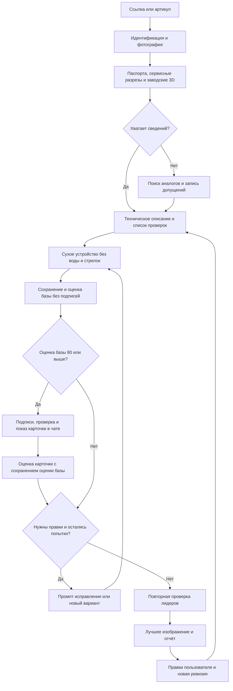

# Plumbing Detailing

**Версия 1.0 зафиксирована 14 октября 2026 года.** Это первая рабочая версия с известными ограничениями, а не подтверждённая техническим специалистом система. [Аудит и ошибки v1.0](docs/review-v1.0.md) · [Согласованные требования и предложения для v1.2](docs/v1.2-plan.md). Код и рабочие инструкции пока сохраняют поведение v1.0: общий рейтинг с подписями, порог 80 и максимум 5 вызовов. Новые требования 90+ / отдельная оценка подписей/официальное фото производителя записаны для v1.2, но ещё не реализованы. Исторические обозначения v0.1 в прежних документах и пилотах сохранены.

Проект агента для создания учебных изображений сантехнических товаров в разрезе по фотографиям магазина и документации производителей.

**Уточнение универсальности, 13 октября 2026 года:** скилл самостоятельно обрабатывает ссылку, название, артикул или фото; пользовательский референс необязателен. Перед генерацией он составляет карту конструкции и конкретные пространственные инструкции из применимых источников. AQUARIO — тестовый пример, не шаблон механизма. [Обновлённый маршрут, ограничения рейтинга и программа проверки](docs/universal-workflow.md). Инструкции обновлены; работа на других семействах ещё не проверена.

**Обновление `main`, 11 октября 2026 года:** внедрён протокол оценки v2 для новых запусков: отдельные признаки существенных узлов, явное подтверждение конкретного факта источником, сводка оснований/неизвестных деталей и состояние готовности отдельно от рейтинга. Максимум нового раунда —5 вызовов, default5, включая неудачные. Веса45/25/15/10/5 сохранены. Архив доказательств и протокол подписей работают как прежде. [Решение и ограничения](docs/scoring-v2-proposal.md).

Ревизия бака завершена 11 октября 2026 года. Лучший новый вариант №9 — **92/100** по текущему списку проверок, 18 подписей, PNG2400×2200. Использованы9 из10 попыток, включая прерванную№8; сохранены восемь PNG. Полный маршрут межступенчатых каналов остаётся непроверенным, точная форма мембраны — реконструкция. Экспертной приёмки нет. Предыдущий запуск10/10 с результатом№8/82 сохранён.

[Скилл](.agents/skills/product-cutaway-agent/SKILL.md) · [Запуск и правки](docs/run-guide.md) · [Журнал работ/ошибок v0.1](docs/development-v0.1.md) · [Новая ревизия и все варианты](pilot/aquario-joker1-100vs/20261010T103041Z-858f303a/final/report.md) · [Предыдущий пилот](pilot/aquario-joker1-100vs/20261009T223138Z-3c5a9d39/final/report.md)

Пользователь задаёт товары ссылками, артикулами или названиями. Агент находит и открывает точную карточку на [477477.ru](https://477477.ru/), копирует полное название и сохраняет именно фото из карточки, показывает их в чате вместе со ссылкой. [Правила получения карточки](.agents/skills/product-cutaway-agent/references/store-card.md). Агент определяет модель, собирает документацию, готовит разрез основных функциональных узлов, проверяет и исправляет изображения в пределах пяти попыток, выбирает лучший вариант и сохраняет все версии вместе с отчётом. Если данных недостаточно, используются обоснованные аналоги; оговорки размещаются в отчёте рядом с изображением.

## Документация

13.10.2026: [самостоятельный пилот AQUASTRONG Aqua SMART2-32](pilot/aquastrong-aqua-smart-2-32/20261013T191059Z-b8bfc689/README.md) завершён через Codex/imagegen: два рабочих PNG, один намеренно ошибочный контроль, лучший83 без подписей/86 с ними. [Проверка рейтинга](docs/aquastrong-pilot.md) выявила реальные дефекты и ограничение: скрипт не распознаёт пиксели, ошибочные наблюдения могут дать высокий балл. Добавлен краткий режим состояния для экономии контекста;79 тестов проходят.

| Документ | Содержание |
|---|---|
| [Ревизия бака AQUARIO](docs/aquario-tank-revision.md) | Новые заводские наблюдения, результат, рейтинг и ограничения |
| [Карта проекта](docs/project-map.md) | Принятые решения, оценка навыков и идеи для проверки |
| [Журнал работ v0.1](docs/development-v0.1.md) | Фактические ошибки, самостоятельные исправления, проверки и нерешённые проблемы |
| [Руководство запуска](docs/run-guide.md) | Использование скилла, среда, продолжение и проверки кода |
| [План сборки скилла](docs/skill-build-plan.md) | Что берём из трёх проектов и как реализуем, проверяем и запускаем скилл через Codex |
| [План тестов](docs/test-plan.md) | Проверки кода и оценщика, пилот на товаре пользователя, самостоятельное исправление ошибок |
| [Протокол рейтинга](docs/scoring-protocol.md) | Наблюдения по пунктам, расчёт баллов, критические ошибки и выбор победителя |
| [Предложение по рейтингу и бюджету](docs/scoring-v2-proposal.md) | Ограничения прежних оценок, проект независимой проверки, ранняя остановка и замеры лимита |
| [Исследование ChatGPT Images](docs/chatgpt-images-research.md) | Обычный веб-чат как альтернативный способ генерации, лимиты и непроверенные этапы |
| [Выдача и экономия токенов](docs/output-and-token-policy.md) | Краткий прогресс, итог в чате и повторное использование контекста |
| [Требования](docs/requirements.md) | Подтверждённые пожелания пользователя, исходный промпт и открытые вопросы |
| [Схема агента v0.1](docs/design-v0.1.md) | Полный проект: этапы, Mermaid-схема, рейтинг, итерации, хранение и правки |
| [План работ](docs/roadmap.md) | Предлагаемая последовательность реализации и проверки |
| [Исследование инструментов](docs/research.md) | Навыки, проекты, MCP и ссылки на документацию товаров |
| [Карта источников производителей](docs/manufacturer-source-map.md) | Заводские 3D/сервисные схемы, разрезы и ограничения по 15 разделам магазина |

## Основной процесс

## Состав первой версии

Реализован собственный навык `product-cutaway-agent`, встроенный инструмент `imagegen` и два помощника: состояние/рейтинг/отчёт и сборка PNG с выносками. Внешние пакетные исполнители рассматриваются как альтернативы при масштабировании; три найденных проекта не установлены и обязательными зависимостями не являются.

Рейтинг предназначен для сравнения вариантов. Его значение не является вероятностью технической правильности. Итог перед размещением проверяют пользователь и технический специалист.

Веса рейтинга45/25/15/10/5 сохранены. Итог — единый PNG, исходная картинка и JSON подписей сохранены. При смене пропорций/разреза точки требуют проверки; helper учитывает масштаб и поля, но не распознаёт узлы. Новый протокол проверяет наличие наблюдений/источников по каждой подписи и соответствие хешей; это проверка агентом, не автоматическое распознавание или независимая экспертиза. Исторические пилоты не получают этот статус задним числом.

78 автоматических проверок механики прошли локально; GitHub Actions включён также для веток `codex/**`. Добавлены проверки архива, привязки подписей, отсутствия расхода попыток и независимости арифметики от порядка. Визуальные ошибки и повторные оценки проверены в пилоте одним Codex, без независимой экспертной калибровки. Это скилл активной задачи, не фоновая очередь.

Во время сборки Codex самостоятельно исправлял обнаруженные проблемы и сохранял нерешённые в журнале. Основной цикл последовательный: один вариант, оценка, правка; подробная история хранится в файлах, прогресс в чате краткий. Исторические пилоты с лимитом10 сохранены; новые раунды используют максимум5 и протокол v2. После второго успешного результата проверяется целесообразность дальнейших генераций. Продолжение по явному запросу создаёт связанный раунд без обнуления истории.

Базовая генерация показывает сухое устройство: без воды, синего заполнения, пузырей и стрелок потока. Объяснение движения воды допускается отдельным редактируемым слоем/выходным файлом по запросу. Сухой мастер сохраняется. Специальный автоматический исполнитель слоя потока пока не реализован; слои подписей уже поддерживаются.

13.10.2026: для новых запусков подписи добавляются только после базы80+. Первый подписанный вариант немедленно показан пользователю как промежуточная карточка. Итогово выбирается один главный PNG, все версии сохранены. База и карточка имеют отдельные оценки, без начисления баллов за гипотетические подписи. Подписи рисует программа, без нового вызова imagegen. Если база не достигает80, порог не объявляется пройденным.

Встроенный Codex/imagegen расходует общий лимит Codex и остаётся способом по умолчанию. По явному выбору пользователя доступен экспериментальный [агентский маршрут обычного ChatGPT Images](.agents/skills/product-cutaway-agent/references/chatgpt-images.md). После входа проверены создание, несколько редактирований, скачивание, сверка/подписи и выбор результата; [раунд AQUARIO](pilot/aquario-joker1-100vs/chatgpt-images-revision-20261013/README.md) завершился91с подписями/86без них. Это браузерная инструкция для агента, не отдельный фоновый сервис. [Исследование](docs/chatgpt-images-research.md) сохраняет сбои и ограничения: экономия лимитов, произвольные следующие запросы в одном чате и пакетная устойчивость не доказаны.

После сравнения с первоначальным референсом пользователь отложил браузерный путь: следующие генерации через Codex/imagegen. [Разбор изображений и предложения](docs/reviews/aquario-reference-20261013/comparison.md) фиксируют упрощение внутренностей, слабые места рейтинга и лишние операции в цикле. Формула/код оценки пока не менялись.
