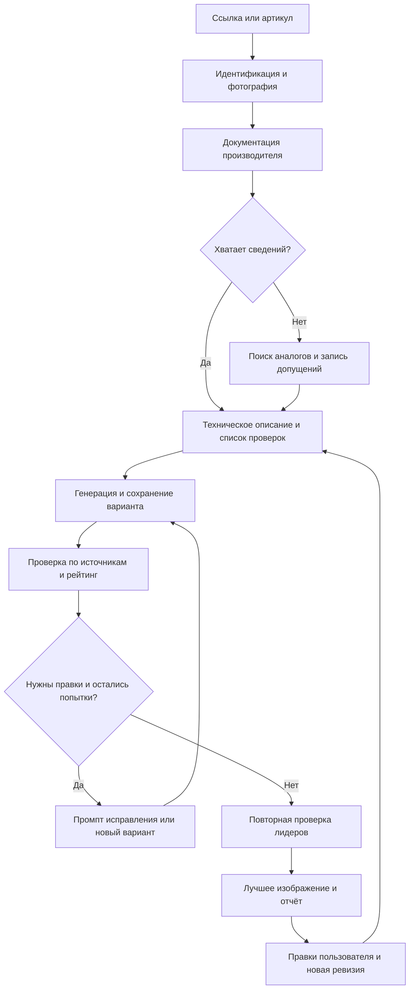

# Plumbing Detailing

Проект агента для создания учебных изображений сантехнических товаров в разрезе по фотографиям магазина и документации производителей.

**Статус:** исследование и проектирование. Здесь сохранена текущая схема для дальнейшего редактирования; работающий агент ещё не реализован. Снимок обсуждения — 10 октября 2026 года.

Пользователь задаёт ссылку или артикул товара на [477477.ru](https://477477.ru/). Агент определяет модель, собирает документацию, готовит разрез основных функциональных узлов, проверяет и исправляет изображения в пределах десяти попыток, выбирает лучший вариант и сохраняет все версии вместе с отчётом. Если данных недостаточно, используются обоснованные аналоги; оговорки размещаются в отчёте рядом с изображением.

## Документация

| Документ | Содержание |
|---|---|
| [Карта проекта](docs/project-map.md) | Принятые решения, оценка навыков и идеи для проверки |
| [План сборки скилла](docs/skill-build-plan.md) | Что берём из трёх проектов и как реализуем, проверяем и запускаем скилл через Codex |
| [План тестов](docs/test-plan.md) | Проверки кода и оценщика, пилот на товаре пользователя, самостоятельное исправление ошибок |
| [Протокол рейтинга](docs/scoring-protocol.md) | Наблюдения по пунктам, расчёт баллов, критические ошибки и выбор победителя |
| [Выдача и экономия токенов](docs/output-and-token-policy.md) | Краткий прогресс, итог в чате и повторное использование контекста |
| [Требования](docs/requirements.md) | Подтверждённые пожелания пользователя, исходный промпт и открытые вопросы |
| [Схема агента v0.1](docs/design-v0.1.md) | Полный проект: этапы, Mermaid-схема, рейтинг, итерации, хранение и правки |
| [План работ](docs/roadmap.md) | Предлагаемая последовательность реализации и проверки |
| [Исследование инструментов](docs/research.md) | Навыки, проекты, MCP и ссылки на документацию товаров |

## Основной процесс

## Направление первой версии

Предлагается собственный навык `product-cutaway-agent`, встроенный инструмент `imagegen` и скрипты для состояния запуска, сохранения версий и учёта попыток. Внешние пакетные исполнители рассматриваются как альтернативы при масштабировании.

Рейтинг предназначен для сравнения вариантов. Его значение не является вероятностью технической правильности. Итог перед размещением проверяют пользователь и технический специалист.

Общая схема поддержана пользователем; текущие веса рейтинга оставлены для пилота с последующей проверкой в тестах. Раздельная подготовка устройства и подписей записана как идея: итог остаётся единым PNG, а редактируемые промежуточные исходники сохраняются отдельно.

Документация инструментов изучена, но их интеграция и реальные генерации ещё не проверялись. Выбор места первого запуска и лимита последующих ревизий пока открыт.

Во время сборки и пилота Codex самостоятельно исправляет обнаруженные ошибки кода и процесса, проверяет исправления и продолжает с сохранённого этапа. Первый реальный товар предоставит пользователь. Три внешних проекта остаются заменяемыми источниками идей, без обязательной установки. Основной цикл последовательный: один вариант, оценка, правка; подробная история хранится в файлах, а прогресс в чате краткий.
