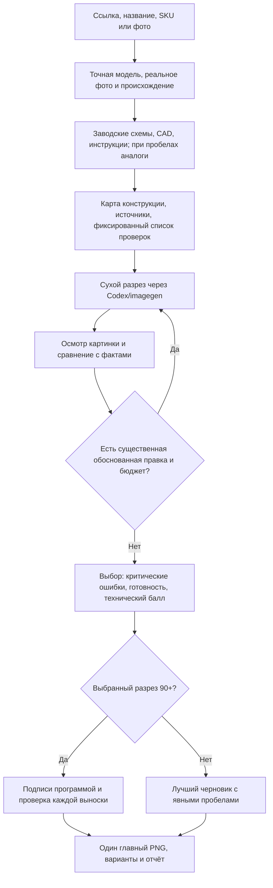

# Plumbing Detailing

**v1.2 — 15 октября 2026 года.** Скилл для создания учебных разрезов сантехники через Codex/imagegen. [v1.0](https://github.com/C555HC/plumbing-detailing-/tree/v1.0) сохранена отдельным тегом; старые пилоты, изображения и баллы не пересчитывались.

Пользователь отправляет ссылку, название, артикул или фото. Агент сам определяет товар на477477.ru, берёт настоящее фото и полное название, исследует внутренности и готовит разрез основных функциональных узлов. Если магазинная карточка/фото недоступны, разрешено официальное фото точной модели производителя с указанием происхождения. Аналоги и пробелы раскрываются в отчёте рядом с картинкой.

[Скилл](.agents/skills/product-cutaway-agent/SKILL.md) · [Запуск](docs/run-guide.md) · [Карта проекта](docs/project-map.md) · [Изменения](CHANGELOG.md) · [Работы и ошибки v1.2](docs/development-v1.2.md)

## Текущий процесс

Новый раунд: **до5 полученных картинок +2 технических повтора, максимум7 вызовов**. Неверная, но полученная картинка считается. Неопределённый ответ блокирует повтор до выяснения. Генерировать все пять необязательно: после второго результата проверяется, есть ли существенная правка. Подписи не требуют вызова imagegen.

Технический рейтинг = `(конструкция45 + связи25 + полнота15) / 85 × 100` по сохранённым наблюдениям. Внешнее сходство и подписи проверяются отдельно; подписи не повышают технический балл. Подписывается только выбранный результат90+, а не проигравшие варианты. Неизвестные факты не исключаются из знаменателя. Формула предварительная, не измеряет вероятность правильности. Высокий балл реконструкции по аналогам не означает подтверждения заводской геометрии.

Сборка подписей теперь автоматически переносит строки, устраняет пересечения текстовых блоков и добавляет белые поля при нехватке места. Размер шрифта сохраняется, точки на деталях остаются прежними относительно изображения. Маршруты выносок и предупреждения сохраняются в `.layout.json`; сложные пересечения требуют визуального осмотра.

Генерация показывает сухое устройство без воды и стрелок потока. Поверхности срезов сохраняют металл/полимер/эластомер без цветной обводки. Итог — обычный единый PNG; исходная база и координаты подписей сохраняются для правок.

## Что реализовано и что ещё проверять

Реализованы регистрация происхождения, обязательная карта конструкции/архив источников или явных пробелов, проверка хешей референсов/review/оценок, разделение технической переоценки и подписей, учёт отправки/сбоев, связанное продолжение и общий кеш источников поURL/модели/редакции/ракурсу. Это механика процесса: скрипты не распознают правильность внутренних деталей на изображении. Ложные наблюдения всё ещё могут дать ложный высокий балл.

**Отдельный проверяющий субагент выключен.** Подготовлен пакет без истории баллов и промпта. Предложен первый ограниченный тест с GPT-6 Luna на финальном кандидате; пользователь отложил эту идею до следующего обсуждения. [Как это устроено и что измерять](.agents/skills/product-cutaway-agent/references/reviewer.md). Независимая экспертная калибровка на нескольких семействах остаётся необходимой; выпуск кодаv1.2 её не заменяет.

Очистка промежуточных файлов записана **только как идея**. Она не выполняется: будущий сценарий потребует отдельного подтверждения удаления и сохранит согласованный финальныйPNG. Исторические материалы и пользовательские файлы сейчас не удаляются.

## Документация и пилоты

| Документ | Содержание |
|---|---|
| [План и статус v1.2](docs/v1.2-plan.md) | Согласованные правила, реализованное, оставшиеся испытания |
| [Аудит v1.0](docs/review-v1.0.md) | R01–R06 и воспроизведения |
| [Журнал v1.2](docs/development-v1.2.md) | Исправления, тесты и ограничения |
| [Журнал v0.1](docs/development-v0.1.md) | Исторические работы и ошибки пилотов |
| [Источники производителей](docs/manufacturer-source-map.md) | Отправные точки поиска, без обещания покрытия всех моделей |
| [Исследование подходов](docs/research.md) | Workflow/исследование/создание скиллов; внешние проекты не обязательные зависимости |
| [Универсальный маршрут](docs/universal-workflow.md) | Исследование разных механизмов; актуальные правилаv1.2 выше |
| [AQUASTRONG и проверка рейтинга](docs/aquastrong-pilot.md) | Реальные найденные ошибки и ложноположительный контроль оценщика |
| [AQUARIO: ревизия бака](docs/aquario-tank-revision.md) | Заводские наблюдения и ограничения прежнего разреза |
| [VALTEC: коллектор](pilot/valtec-vtc-586-emnx-0606/20261013T212259Z-be780207/README.md) | Исторический самостоятельный пилот,2 генерации |
| [Эксперимент ChatGPT Images](docs/chatgpt-images-research.md) | Браузерный путь отложен пользователем, экономия не доказана |

Старыеv0.1/v1.0 планы, схемы и оценки сохраняют исторические параметры80/5или10; они не заменяют текущий SKILL.md. Техническая приёмка перед размещением остаётся за пользователем и специалистом.
