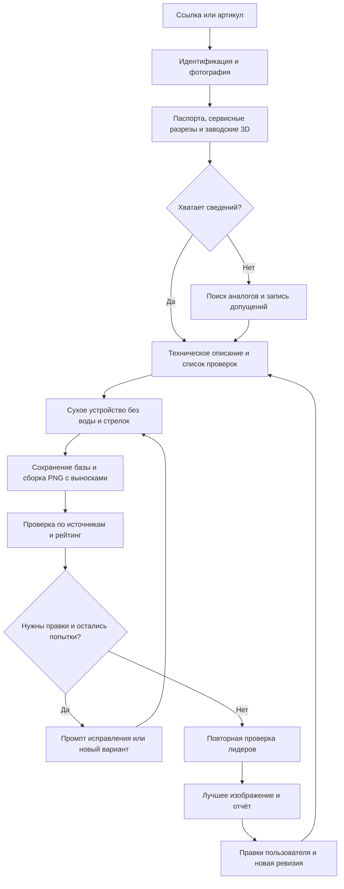

# Plumbing Detailing

Проект агента для создания учебных изображений сантехнических товаров в разрезе по фотографиям магазина и документации производителей.

**Статус:** первая версия скилла реализована и проверена в активной задаче Codex, 10 октября 2026 года. Пилот AQUARIO Joker1-100VS завершён: 10/10 генераций, включая четыре исправления по заводской 3D-сборке и новому требованию сухого устройства. Выбран №8, 82/100; №9/10 имеют тот же рейтинг. Форма ротора приближена к заводской чашке, вода и стрелки убраны. Точная посадка ротора/статора и все межступенчатые каналы остаются непроверенными. Экспертной приёмки нет. Старые 92/100 относятся к прежним критериям и сохранены в архиве.

[Скилл](.agents/skills/product-cutaway-agent/SKILL.md) · [Запуск и правки](docs/run-guide.md) · [Журнал работ/ошибок v0.1](docs/development-v0.1.md) · [Пилот и все варианты](pilot/aquario-joker1-100vs/20261009T223138Z-3c5a9d39/final/report.md)

Пользователь задаёт ссылку или артикул товара на [477477.ru](https://477477.ru/). Агент определяет модель, собирает документацию, готовит разрез основных функциональных узлов, проверяет и исправляет изображения в пределах десяти попыток, выбирает лучший вариант и сохраняет все версии вместе с отчётом. Если данных недостаточно, используются обоснованные аналоги; оговорки размещаются в отчёте рядом с изображением.

## Документация

| Документ | Содержание |
|---|---|
| [Карта проекта](docs/project-map.md) | Принятые решения, оценка навыков и идеи для проверки |
| [Журнал работ v0.1](docs/development-v0.1.md) | Фактические ошибки, самостоятельные исправления, проверки и нерешённые проблемы |
| [Руководство запуска](docs/run-guide.md) | Использование скилла, среда, продолжение и проверки кода |
| [План сборки скилла](docs/skill-build-plan.md) | Что берём из трёх проектов и как реализуем, проверяем и запускаем скилл через Codex |
| [План тестов](docs/test-plan.md) | Проверки кода и оценщика, пилот на товаре пользователя, самостоятельное исправление ошибок |
| [Протокол рейтинга](docs/scoring-protocol.md) | Наблюдения по пунктам, расчёт баллов, критические ошибки и выбор победителя |
| [Выдача и экономия токенов](docs/output-and-token-policy.md) | Краткий прогресс, итог в чате и повторное использование контекста |
| [Требования](docs/requirements.md) | Подтверждённые пожелания пользователя, исходный промпт и открытые вопросы |
| [Схема агента v0.1](docs/design-v0.1.md) | Полный проект: этапы, Mermaid-схема, рейтинг, итерации, хранение и правки |
| [План работ](docs/roadmap.md) | Предлагаемая последовательность реализации и проверки |
| [Исследование инструментов](docs/research.md) | Навыки, проекты, MCP и ссылки на документацию товаров |
| [Карта источников производителей](docs/manufacturer-source-map.md) | Заводские 3D/сервисные схемы, разрезы и ограничения по 15 разделам магазина |

## Основной процесс

## Состав первой версии

Реализован собственный навык `product-cutaway-agent`, встроенный инструмент `imagegen` и два помощника: состояние/рейтинг/отчёт и сборка PNG с выносками. Внешние пакетные исполнители рассматриваются как альтернативы при масштабировании; три найденных проекта не установлены и обязательными зависимостями не являются.

Рейтинг предназначен для сравнения вариантов. Его значение не является вероятностью технической правильности. Итог перед размещением проверяют пользователь и технический специалист.

Веса рейтинга 45/25/15/10/5 сохранены. Раздельная подготовка устройства и подписей проверена на пилоте: итог — единый PNG 2000×1800, исходная картинка и JSON подписей сохранены. При смене пропорций/разреза точки требуют проверки; helper учитывает масштаб и поля, но не распознаёт узлы.

38 автоматических проверок механики проходят локально; настроен GitHub Actions. Визуальные ошибки и повторные оценки проверены в пилоте одним Codex, без независимой экспертной калибровки. Это скилл активной задачи, не фоновая очередь.

Во время сборки Codex самостоятельно исправлял обнаруженные проблемы и сохранял нерешённые в журнале. Основной цикл последовательный: один вариант, оценка, правка; подробная история хранится в файлах, прогресс в чате краткий. Лимит последующих пользовательских ревизий после исчерпания первоначального бюджета остаётся отдельным решением.

Базовая генерация показывает сухое устройство: без воды, синего заполнения, пузырей и стрелок потока. Объяснение движения воды допускается отдельным редактируемым слоем/выходным файлом по запросу. Сухой мастер сохраняется. Специальный автоматический исполнитель слоя потока пока не реализован; слои подписей уже поддерживаются.
