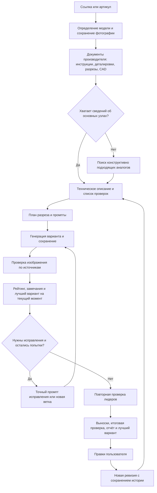

# Агент для учебных разрезов товаров — проект v0.1

Дата исследования: 10 октября 2026 года. Это проект для согласования, а не установленный агент. Внешние инструменты изучены по документации; генерации и проверка их исполнения ещё не проводились.

После обсуждения пользователь поддержал общую схему и оставил текущий рейтинг для пилота с последующей доработкой по тестам. Идея раздельной подготовки частей изображения записана для проверки. Актуальные решения и отбор инструментов — в [карте проекта](project-map.md).

## 1. Что должен получить пользователь

Вход: ссылка на товар 477477.ru или однозначно найденный артикул. Агент сам получает фотографию с карточки, определяет модель, находит документы производителя, составляет техническое описание, генерирует и исправляет разрез, сравнивает варианты и выбирает лучший.

Результат: готовая учебная иллюстрация на белом фоне, похожая на предоставленный пример. Сохраняются внешний вид товара и основные функциональные узлы. Русские выноски объясняют устройство. Изображение не обязано показывать каждый винт или электронный компонент.

Все полученные картинки сохраняются. В отдельном отчёте: рейтинг, основания выбора, источники, недостающие данные, использованные аналоги и оставшиеся замечания. Оговорки об аналогах размещаются только в отчёте, по указанию пользователя.

Первый этап — один товар без необходимости следить за каждой итерацией. Далее — несколько независимых запусков, в том числе в разных чатах. После результата пользователь может продолжить работу обычным сообщением с правками. Перед публикацией результат проверяют пользователь и технический специалист.

## 2. Общая схема



Если точная идентификация невозможна, требуется контекстный вопрос. Если не удаётся найти достоверную основу даже для аналоговой реконструкции, агент описывает пробелы: поиск аналогов не даёт разрешения придумывать произвольный механизм.

## 3. Этапы

### Идентификация

Зафиксировать бренд, полную модель, артикул магазина, артикул производителя, модификацию и доступные признаки исполнения. Фотография определяет внешний вид, а не невидимые внутренности. Проверить соответствие изображения карточке и документации. У многовариантного товара не смешивать размеры и исполнения.

### Поиск документации

Искать инструкции, технические паспорта, сервисные руководства, взрыв-схемы, каталоги запчастей, заводские разрезы и CAD. Для каждого источника сохранять URL, издателя, модель/серию, редакцию, дату получения и применимость к товару. Сохранять сами файлы и нужные страницы/изображения. При чтении PDF изучать иллюстрации вместе с текстом.

CAD сначала проверяется на состав: наружная оболочка для проектирования трубопроводов не доказывает устройство внутренних узлов. Первоочередная задача — извлечь подтверждённую конструкцию, а не перевести любой доступный файл в красивую картинку.

### Работа с аналогами

Порядок поиска: та же модель и её сервисные документы → подтверждённо общая конструкция в той же серии → конструктивно эквивалентные изделия других производителей. Сходство названия или внешнего вида недостаточно.

Сравнивать принцип действия, тип привода, количество ступеней, расположение патрубков, устройство уплотнений и иные существенные параметры. Аналог дополняет конкретный пробел, а не заменяет всё изделие. Его документация не может отменить сведения производителя целевого товара.

Для каждого утверждения использовать один из статусов:

- подтверждено документами точной модели;
- подтверждено документами серии с обоснованной применимостью;
- восстановлено по указанному аналогу;
- остаётся неизвестным.

Подтверждённое наличие детали и её точная форма — разные утверждения. Если инструкция сообщает о клапане, это ещё не подтверждает любую нарисованную форму клапана.

### Техническое описание

Составить список функциональных узлов, их назначения, расположения, связей и пути рабочей среды. Для каждого пункта записать источник и страницу/рисунок. Отдельно перечислить ограничения: подтверждённое число ступеней, положение клапана, тип двигателя, материалы, отсутствующие детали и др.

На этой основе создать неизменяемый для данной ревизии список проверок. Допускается менять его после появления новых документов или технической правки пользователя, но тогда ранее созданные кандидаты необходимо переоценить по той же новой версии правил.

### План изображения

Фотография магазина — ориентир внешнего вида. Чертежи и деталировки — ориентир конструкции. Присланный пример — ориентир стиля. При передаче нескольких изображений каждому присваивается роль.

Выбрать окно/плоскость разреза, чтобы показать основные узлы и объяснить работу. По умолчанию сохранить узнаваемый ракурс исходной фотографии. Предусмотреть место для названия и русских выносок.

Предлагается генерировать внутреннее устройство без длинных подписей, а заголовок, подписи и линии размещать отдельным редактируемым слоем. Итоговый PNG выглядит как единое готовое изображение. Проверка точек привязки обязательна: точный текст не спасает неверно направленную выноску.

Слой здесь означает промежуточный исходник: генератор создаёт изображение устройства, затем программа наносит текст и линии и сохраняет единый PNG. Сам PNG слои не хранит. Для правок отдельно сохраняются изображение без текста и данные подписей/координат. PowerPoint не требуется. Дополнительно можно выделять области узлов для увеличенной проверки и локальной правки; независимая генерация каждого внутреннего узла пока не является обязательной частью процесса.

### Генерация и исправления

Первый вариант лимита: максимум 10 вызовов генератора/редактора на исходный запуск, по одному выходному изображению в вызове. Повторный запуск после ошибки тоже расходует попытку; ожидание уже принятого задания — нет. Поисковые операции, оценки и обычная вёрстка текста генерациями не считаются.

Уточнённый основной режим: один исходный кандидат, проверка, затем исправление или новый кандидат по замечаниям в оставшемся лимите. Обязательные три стартовых кандидата не нужны. Все варианты используют общие основания конструкции и стиля; новый способ раскрытия внутренностей допускается, если предыдущий не помогает объяснить работу.

После каждого вызова немедленно сохранить результат, промпт, входные изображения, настройки, номер попытки, идентификатор запроса, родительскую версию, статус и доступные сведения о затратах.

Проверяющий анализирует изображение целиком и увеличенные области сложных узлов. Он получает исходные документы и список проверок. Утверждение генератора, что результат корректен, не считается доказательством. Неразличимый узел получает статус «не удалось проверить».

Промпт исправления содержит: наблюдаемый дефект, подтверждающий источник, необходимое изменение и уже правильные детали, которые нужно сохранить. За проход исправлять одну проблему или связанный узел. Если общая конструкция ошибочна, полезнее новая генерация из исходной фотографии и технического описания.

Каждую правку проверять полностью: редактирование одной области может изменить другие. Сохранять лучшую предыдущую версию; очередной результат не становится победителем автоматически.

## 4. Предлагаемый рейтинг

Это шкала сравнения вариантов, а не вероятность технической правильности. Начальные веса нужно проверить на пилоте вместе со специалистом.

По решению пользователя текущие веса оставляем для пилота. После тестов нужно отдельно оценить качество выбора победителя, стабильность оценок, выявление критических ошибок и учёт неподтверждённых сведений; по результатам возможна доработка критериев и весов.

| Критерий | Вес |
|---|---:|
| Соответствие подтверждённым требованиям конструкции | 45 |
| Расположение узлов, связи и физически понятный путь рабочей среды | 25 |
| Полнота основных функциональных узлов | 15 |
| Узнаваемость внешнего вида товара | 10 |
| Читаемость изображения и корректность выносок | 5 |
| Всего | 100 |

Каждый критерий разбивается на пункты с заранее заданными максимальными баллами и правилами наблюдения. Для проверяемого пункта: соответствует = 1; частично = 0,5; не соответствует или не удаётся проверить = 0. Баллы пункта — его максимум, умноженный на статус; баллы блока — сумма пунктов. Частичный балл требует заранее определённого условия и объяснения. Неприменимые вопросы исключаются до распределения веса внутри блока, одинаково для всех кандидатов. Отсутствие документации не означает неприменимость; баллы полностью неоценённого блока не переносятся на внешний вид.

Конкретный процесс подготовки checklist, осмотра, расчёта и выбора описан в [протоколе рейтинга](scoring-protocol.md). Скрипт вычисляет сумму из наблюдений агента, но не определяет техническую правильность по пикселям самостоятельно.

Расположение/связи, восстановленные по аналогам, оцениваются как согласованность реконструкции с её основаниями и помечаются в отчёте. Они не становятся подтверждёнными требованиями конкретной модели.

Отдельно выводится обеспеченность данными: какие ключевые узлы/связи подтверждены точной моделью, серией, аналогами или не подтверждены. Можно показывать взвешенную долю подтверждённых требований, но число всегда сопровождается перечнем, чтобы не выдавать оценку покрытия за измерение точности.

Критические противоречия учитываются раньше общего балла: неверный принцип действия, другое число ступеней, несовместимый двигатель, неверное положение важного клапана, невозможный путь жидкости. Сначала выбираются кандидаты без таких противоречий; далее — лучший по рейтингу. Если они есть у всех, выбирается лучший доступный кандидат и явно перечисляются его нерешённые противоречия.

Перед итогом два лидера повторно проверяются в отдельном проходе без прежних баллов и истории похвал. Это снижает влияние предыдущих оценок, но не гарантирует независимость ошибок модели. При близких результатах показываются оба с объяснением различий.

Остановка: исчерпан лимит, выполнены проверяемые требования и не осталось существенных исправлений, либо повторные изменения не улучшают результат. Лучшая картинка выдаётся вместе с отчётом. Статус «лучший вариант» отличается от последующего одобрения техническим специалистом.

Во время работы в чат выводится только номер следующей генерации, рейтинг предыдущей и существенные замечания. В итоговой выдаче показывается главный PNG и краткая история остальных версий. Полная проверка остаётся в файлах; повторно используются сохранённые источники и техническое описание. Подробности — в [политике выдачи и экономии токенов](output-and-token-policy.md).

## 5. Продолжение по правкам

Комментарий пользователя сохраняется дословно. Агент определяет, затрагивает ли он внешний вид, выноски или техническую конструкцию. Для технической правки проверяет источник/приложенную специалистом схему; при противоречии с документацией объясняет конфликт и уточняет его.

Новая ревизия ответвляется от выбранного изображения. Не требуется повторно искать все документы, если модель и основания не менялись. После правки повторяются проверка, рейтинг и отчёт. Старые варианты сохраняются. Формат нового лимита для пользовательских ревизий ещё нужно согласовать; нельзя автоматически расходовать ещё десять попыток без определённого правила.

## 6. Хранение и независимые запуски

Каждый товар и каждый запуск имеют собственные product_id, run_id и папку. Один и тот же товар можно обрабатывать параллельно без перезаписи. Состояние хранится в файлах, поэтому восстановление не зависит только от истории чата или временной сессии MCP.

```text
cutaways/
  <brand>_<article>/
    <run_id>/
      input/                 # фотография, карточка и идентификация
      sources/               # документы, выдержки и схемы
      technical-spec.json    # узлы, связи, ограничения и источники
      checklist.json         # общие правила проверки кандидатов
      attempts/
        001/                 # image.png, prompt.md, request.json, review.json
        002/
      labels/                # текст и координаты выносок
      ranking.json
      state.json             # этап, учёт попыток и незавершённые запросы
      final/
        best.png
        report.md
        contact-sheet.jpg    # сравнение всех вариантов
      revisions/
```

В общем реестре заданий записываются товар, этап, папка результата и выбранная версия. При общем сервере дополнительно нужны блокировки, ограничение числа одновременных вызовов и атомарное сохранение состояния. Если запрос уже принят провайдером, после таймаута сначала проверить его статус, а не слепо запускать повторную генерацию.

## 7. Найденные навыки и инструменты

### Встроенный imagegen

Уже доступен в текущем окружении. Даёт генерацию по референсам, редактирование, осмотр и целевые итерации с сохранением инвариантов. Для первого пилота это предлагаемый исполнитель изображений. Управление источниками, рейтингом и десятью попытками нужно реализовать нашим навыком и состоянием запуска. Обычная генерация использует встроенный инструмент; CLI/API — отдельный режим.

Источник: встроенный навык `imagegen`, инструкция `.system/imagegen/SKILL.md` в окружении Codex. Абсолютный путь зависит от установки.

### baoyu-image-gen

Поддерживает сохранённые промпты, референсы, явные пути результата, JSON-вывод и пакет заданий с ограниченным числом исполнителей. Полезен для позднего запуска нескольких товаров и воспроизводимого исполнения. Это исполнитель, а не технический проверяющий. Провайдеры и режимы отличаются; автоматическое переключение для нашего конвейера следует заменить явно выбранным режимом.

[Инструкция навыка](https://github.com/JimLiu/baoyu-skills/blob/main/skills/baoyu-image-gen/SKILL.md).

### Replicate run-models

Навык самого Replicate описывает создание заданий, проверку схемы модели, опрос статуса, webhooks, последовательные зависимости и параллельные независимые задания. Он полезен для серверного исполнения и учёта незавершённых запросов. Выходные файлы требуется сохранять самостоятельно. Понадобятся подключение Replicate и наш слой проверки изделия.

[Инструкция навыка](https://github.com/replicate/skills/blob/main/skills/run-models/SKILL.md), [документация Replicate о навыках](https://replicate.com/docs/reference/skills/).

### fal-workflow

Навык из fal-ai-community описывает графы зависимостей и локальную оркестрацию через genmedia. Его справочники разделяют планирование, генерацию, редактирование, QA и manifest. Для нашего случая особенно полезны точечные изменения с сохранением правильных деталей и сохранение ID каждого запроса. Динамический цикл оценки подходит локальной оркестрации лучше фиксированного графа. Требует инфраструктуры fal; проверку по документации производителя надо написать отдельно.

[Инструкция](https://github.com/fal-ai-community/skills/blob/main/skills/fal-workflow/SKILL.md), [правила этапов](https://github.com/fal-ai-community/skills/blob/main/skills/fal-workflow/references/node-rules.md), [шаблоны конвейеров](https://github.com/fal-ai-community/skills/blob/main/skills/fal-workflow/references/pipeline-patterns.md).

### fal-skill-creator от inovue

Сторонний проект превращает модели в профили с закреплёнными параметрами и шаблонами промптов. Его CLI валидирует запрос, отправляет его, получает результат и пишет manifest. Процессы можно экспортировать в отдельный навык; README описывает возобновление получения результатов и пакетное исполнение. Это подходящая архитектурная заготовка для повторяемого производства, но она привязана к fal и не знает конструкцию товара.

[Инструкция](https://github.com/inovue/fal-skills/blob/main/skills/fal-skill-creator/SKILL.md), [репозиторий](https://github.com/inovue/fal-skills).

### PaperVizAgent / PaperBanana

Это проект, а не установленный в данном окружении навык. Организует подготовку научных иллюстраций через роли планирования, генерации и критики с повторными исправлениями. Есть просмотр эволюции кандидатов и дальнейшее редактирование. Полезен как образец цикла проверки, но его научные диаграммы не подтверждают качество разрезов насосов; инженерные критерии должны быть заменены нашими.

[Официальный репозиторий исследовательского проекта](https://github.com/google-research/papervizagent).

### MCP генерации и FreeCAD

[image-mcp](https://github.com/xieyuanqing/image-mcp) предоставляет генерацию, редактирование, сессии и сохранение файлов. Состояние сессий в памяти не заменяет постоянную историю нашего задания. [FreeCAD MCP](https://github.com/tessalabs-space/freecad-mcp) интересен для ветки с полноценными CAD-моделями. Это инструменты исполнения, а не готовый агент проверки реальных товаров.

## 8. Предлагаемая сборка первой версии

Один собственный навык условно `product-cutaway-agent` управляет всем процессом: поиском, техническим описанием, проверкой, рейтингом и ревизиями. Скрипты ведут папки, учёт попыток и состояние. Встроенный imagegen выполняет генерацию. Чтение PDF/изображений и веб-поиск обеспечивают сбор доказательств.

Этапы можно выполнять одним агентом в отдельных проходах. Несколько ролей не требуют нескольких параллельных агентов. После пилота можно выделить независимого проверяющего; общая модель всё равно может повторять одинаковые ошибки.

Для нескольких товаров сначала достаточно отдельных запусков с отдельными папками. Для постоянной очереди и работы вне активного чата нужен исполнитель заданий; один SKILL.md не обеспечивает фоновый сервис. API-путь следует выбирать отдельно от пилота и проверить реальным запуском.

Из найденного для первого прототипа выбирается imagegen; PaperVizAgent и fal-workflow дают полезные образцы. baoyu-image-gen, Replicate и fal являются альтернативами исполнения при масштабировании, а не обязательными одновременными зависимостями.

## 9. Пилот и проверка рейтинга

Первый товар целесообразно взять из пользовательского примера: AQUARIO JOKER1-100VS. В его инструкции есть проверяемые ограничения, в том числе число ступеней и расположение тестового обратного клапана. Затем проверить VALTEC VT.417.N.04 как другой тип изделия.

Успех пилота: все версии и основания сохранены; лимит соблюдён; известные конструктивные ошибки обнаруживаются; выбранный вариант технический специалист считает лучшим или объясняет расхождение. По его замечаниям корректируются список проверок и веса рейтинга. Это проверка полезности рейтинга, а не доказательство универсальной точности.

Источники товаров:

- [Карточка ESPA](https://477477.ru/catalog/nasosy/espa-167577), [документы ESPA](https://psp.espa.com/corp-es/product/tecnoplus-25-4m/5711).
- [Карточка VALTEC](https://477477.ru/catalog/armatura-i-komplektuyuschie/valtec-vt-417-n-04), [документы VALTEC](https://valtec.ru/catalog/truboprovodnaya_armatura/sharovye_krany_valtec_gost/kran_sharovoj_gost_s_ruchkoj_babochkoj_i_vnutrennej_rezboj.html).
- [Инструкция AQUARIO JOKER1-100VS](https://aquario.ru/sites/default/files/manuals/Joker_0.pdf).
- [OpenAI: генерация и последовательное редактирование](https://developers.openai.com/api/docs/guides/image-generation).

## 10. Вопросы, не препятствующие согласованию схемы

1. Первый запуск прямо в этих чатах Codex или сразу отдельный сервис? Рабочее предположение для пилота — здесь.
2. Для последующих пользовательских правок новый лимит до 10 попыток на ревизию или меньший лимит? До согласования автоматическое продолжение после исчерпания исходного лимита не предусмотрено.
3. Стрелки движения воды/рабочей среды нужны всегда, когда они помогают объяснить работу, или только выноски, как в примере? Рабочее предположение — добавлять только когда они улучшают понимание.
