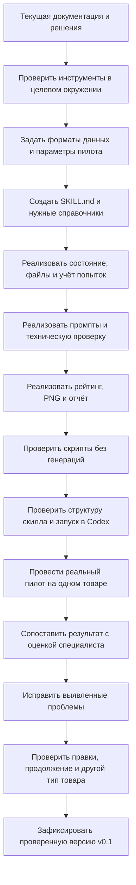

# План сборки скилла product-cutaway-agent

Дата: 10 октября 2026 года. Это исходный план реализации через Codex. Первая версия теперь создана; фактический состав, пилот и отличия от плана описаны в [журнале v0.1](development-v0.1.md) и [руководстве запуска](run-guide.md). Обязанности помощников объединены в cutaway.py и compose_png.py вместо нескольких отдельных скриптов. Остальной текст сохраняет исходную последовательность проектирования.

## 1. Что создаём

Первая версия — скилл для агента Codex: инструкции, справочные правила и небольшие исполняемые помощники. Codex читает скилл, ищет источники, анализирует изображения, вызывает встроенный imagegen и выполняет скрипты. Скилл не является отдельной моделью или постоянно работающим сервисом.

Название: `product-cutaway-agent`. Предлагаемое расположение в репозитории: `.agents/skills/product-cutaway-agent/`. Это сохраняет исходники скилла в Git и позволяет использовать его в проекте. Для применения вне репозитория позднее можно сделать пользовательскую установку.

Пример будущего запуска: `$product-cutaway-agent Сделай учебный разрез товара по этой ссылке: ...`. Режимы: создание разреза, продолжение существующего запуска, правки выбранной версии.

Официальная документация описывает скилл как SKILL.md с необязательными scripts, references и assets; скиллы проекта размещаются в `.agents/skills`. [OpenAI: Skills](https://learn.chatgpt.com/docs/customization/overview#skills).

## 2. Как используем три найденных подхода

### fal-workflow: устройство процесса

Берём разделение этапов, зависимости, правила сохранения важных деталей при редактировании, проверку после изменения и запись входов/выходов. Адаптация: описание изделия должно быть готово до генерации; результат каждого этапа сохраняется в отдельный файл; исправление зависит от конкретного замечания проверяющего.

Наше воплощение — маршрут в SKILL.md, форматы этапов в references и журнал состояния в run_state.py. Разделы видео, облачный формат workflow и привязка к fal/genmedia для пилота не нужны.

[Источник: fal-workflow](https://github.com/fal-ai-community/skills/blob/main/skills/fal-workflow/SKILL.md), [правила этапов](https://github.com/fal-ai-community/skills/blob/main/skills/fal-workflow/references/node-rules.md).

### PaperVizAgent / PaperBanana: проверка и исправления

Берём цикл планирования, визуализации, критики и повторного улучшения. Для нас критик проверяет узлы, расположение, рабочий путь, число ступеней и другие требования из документации. Образцы научных диаграмм заменяются фотографией товара и заводскими схемами.

Наше воплощение — процедуры review и revise, структурированный review.json, работа с увеличенными областями и повторная проверка лидеров. Роли могут исполняться одним Codex в отдельных проходах. Это не означает запуск всего исследовательского проекта или обязательную команду параллельных агентов.

[Источник: оригинальный PaperVizAgent](https://github.com/google-research/papervizagent).

### fal-skill-creator от inovue: воспроизводимость

Берём закреплённые настройки, шаблоны промптов с переменными, проверку входов и manifest каждого запуска. Наши шаблоны будут разделять внешний вид, техническую конструкцию, требования проверки и конкретные изменения.

Наше воплощение — профиль пилота, проверяемые форматы данных и сохранение фактического промпта/референсов каждой попытки. Встроенный imagegen вызывает сам Codex; Python-помощник не получает прямой доступ к этому инструменту. fal-исполнитель и API-профили могут появиться позже при реальной необходимости.

[Источник: fal-skill-creator](https://github.com/inovue/fal-skills/blob/main/skills/fal-skill-creator/SKILL.md).

## 3. Структура будущего скилла

```text
.agents/skills/product-cutaway-agent/
  SKILL.md
  agents/openai.yaml             # имя и описание в интерфейсе
  references/
    evidence.md                 # модель, применимость документов, аналоги
    review.md                   # проверки, ошибки, рейтинг, выбор
    prompts.md                  # создание, проверка, точечная правка
    formats.md                  # договорённости об узлах и файлах
    revisions.md                # продолжение, новые версии и лимиты
  scripts/
    run_state.py                # запуск, этапы, попытки, возобновление
    artifacts.py                # сохранение файлов, увеличенные области, сравнение
    rank.py                     # расчёт рейтинга из проверок
    compose_png.py              # подписи и линии, сборка итогового PNG
    report.py                   # отчёт из сохранённых оснований и оценок
  assets/
    pilot-profile.json          # согласованные параметры пилота
    schemas/                    # проверка структуры входов и результатов
```

Это предполагаемые обязанности, а не требование создать все файлы заранее. Во время реализации помощники можно объединять, если это уменьшает сложность без потери ясности. У скилла будет короткий входной SKILL.md; подробности читаются по мере необходимости.

Генерации и документы товаров сохраняются в локальных папках запусков. В Git версионируются исходники и необходимые тестовые данные; рабочие результаты не добавляются автоматически.

## 4. Схема сборки через Codex



## 5. Последовательность реализации

### Шаг 1. Проверить среду исполнения

Codex проверяет доступность встроенной генерации/редактирования, просмотра изображений, веб-поиска, файлов и подходящего Python для помощников. Для пилота выбирает минимальные зависимости для чтения PDF, работы с изображениями и кириллицей. Проверяет получение одного реального результата в ходе пилота.

Встроенный imagegen — инструмент агента. Скилл не обещает вызывать его из произвольного Python-скрипта или сохранять доступ к нему при переносе в другое окружение. Если инструмент отсутствует, способ исполнения выбирается явно.

### Шаг 2. Определить форматы результатов

Создать форматы:

- product.json: карточка, артикулы, модель и модификация;
- sources.json: издатель, URL, редакция, файл, применимость и нужные страницы;
- technical-spec.json: узлы, назначения, расположение, связи и ограничения;
- checklist.json: требования, источники, значимость и версия правил;
- review.json: наблюдения по изображению, соответствие, неопределённость, ошибки и области;
- attempt.json: промпт, входы, выход, родительская версия, настройки и статус;
- labels.json: точные подписи, координаты, точки привязки и оформление;
- state.json: этап, лимит, учёт попыток и незавершённые действия.

Проверять структуру скриптами. Источник утверждения и его статус обязательны. Подтверждённое наличие узла не означает подтверждённую форму каждой детали.

### Шаг 3. Написать скилл и процедуру подготовки товара

SKILL.md описывает назначение, режимы и обязательные переходы процесса. Codex получает товар, сохраняет фотографию, собирает источники и готовит техническое описание. Если модель неоднозначна, задаёт контекстный вопрос. Пробелы по конструкции дополняет по подходящим аналогам с записью основания.

Справочник evidence.md помогает отличать документацию модели от документации серии и аналога. В скилл не зашивается фиксированная конструкция насоса: список узлов строится заново для товара.

### Шаг 4. Сделать постоянное состояние и хранение

Создать уникальные product_id/run_id, отдельные папки и сохранение после каждого этапа. Перед вызовом генератора Codex резервирует попытку через помощник; после результата сохраняет файл и закрывает запись попытки. По рабочему правилу один вызов производит одно изображение, повторный вызов расходует новую попытку.

Помощник отказывает в выдаче следующей попытки после лимита. В режиме встроенного imagegen соблюдение протокола также зависит от инструкции Codex; скрипт не перехватывает все возможные вызовы инструмента. Для строгого ограничения на уровне сервиса позже потребуется единая точка API-вызова.

Состояние пишется атомарно, а конкурирующие операции блокируются для одного запуска. При восстановлении проверяются уже сохранённые файлы и доступные ID запроса. Если исход вызова неизвестен, он отмечается явно; новый вызов не выдаётся за продолжение старого.

### Шаг 5. Подготовить генерацию, review и revise

Шаблоны содержат роли входных изображений, технические ограничения, оформление и сохранение правильных деталей. Основной цикл последовательный: один первый кандидат, проверка, затем целевая правка или новый кандидат. Проверяющий проход изучает полный кадр и области узлов вместе с источниками. Подробный [протокол рейтинга](scoring-protocol.md) задаёт требования к наблюдениям и расчёту; краткая выдача описана в [политике экономии контекста](output-and-token-policy.md).

Проверка пишет фактические наблюдения и замечания. Скрипт rank.py считает баллы по этим наблюдениям; он сам не распознаёт физическое устройство по пикселям. Следующий промпт строится из конкретного замечания. При общей ошибке допускается новый кандидат вместо цепочки ухудшающих правок.

Лучшая предыдущая версия сохраняется. Если появились новые технические основания, все сравниваемые варианты переоцениваются по общей новой версии списка проверок.

### Шаг 6. Реализовать итоговый PNG и отчёт

Сначала проверить предложенную сборку: изображение устройства плюс программно нанесённые подписи и линии. compose_png.py читает labels.json, рисует кириллицу и сохраняет единый PNG. Проверяются границы, читаемость, наложения и точки привязки. Семантическую правильность указания линии проверяет агент, а затем специалист.

Отчёт собирается из источников, проверок, рейтинга и допущений. Создаётся сравнительный лист вариантов. Пользователь получает лучший PNG, весь набор версий и отчёт. Если составное оформление на пилоте работает плохо, способ корректируется по результатам; итоговый формат PNG сохраняется.

### Шаг 7. Проверить механику без реальных генераций

Полная матрица проверок и необходимые входы находятся в [плане тестов](test-plan.md). Во время сборки Codex самостоятельно исправляет найденные ошибки кода и архитектуры, выполняет подходящие повторные проверки и возвращается к сохранённому этапу пилота. Исправление не обнуляет лимит реальных генераций.

Проверки должны подтверждать важные свойства:

- попытку 11 нельзя зарезервировать;
- два запуска одного товара получают разные папки;
- восстановление не уничтожает готовые версии;
- ошибка генерации отражена в счётчике и состоянии;
- критические противоречия учитываются раньше привлекательного оформления;
- аналог не превращается в документальное подтверждение целевой модели;
- кириллица сохраняется в PNG, а изменение подписи не требует нового изображения устройства.

Тест ранжирования с подготовленным review.json проверяет расчёт, но не доказывает, что визуальный проверяющий сам найдёт ошибку. Это проверяется только в реальном пилоте.

### Шаг 8. Проверить структуру и включение скилла

Проверить frontmatter, ссылки, отсутствие заглушек и доступность нужных ресурсов. Использовать quick_validate.py из встроенного skill-creator, затем отдельно проверить сценарий реального вызова. Валидатор структуры не доказывает качество решений или изображений.

Проверить обнаружение скилла в проекте и явный запуск по имени. Для аккуратного интерфейса добавить agents/openai.yaml по поддерживаемому формату. Каждый скрипт, который реально используется, выполнить и проверить.

### Шаг 9. Провести реальный пилот

Первый пилотный товар предоставит пользователь. Сохранить фотографию и источники, запустить цикл максимум десяти генераций, получить рейтинг и лучший PNG. AQUARIO JOKER1-100VS из присланного примера можно использовать как отдельный контрольный случай.

Проверить известные ограничения инструкции, а затем сопоставить выбор агента с оценкой технического специалиста. Пользовательский пример можно отдельно дать проверяющему как самостоятельный кандидат: посмотреть, выявляет ли он расхождение положения клапана, не подсказывая ему ответ.

Текущие веса 45/25/15/10/5 сохраняются до тестов. По фактическим ошибкам дорабатываются критерии, шаблоны и поведение; изменения рейтинга фиксируются отдельно.

### Шаг 10. Проверить продолжение и перенос на другие товары

Проверить изменение подписи, локальную техническую правку и восстановление прерванного запуска. Затем применить процесс к другому типу изделия, например VALTEC VT.417.N.04. После этого проверить несколько независимых запусков.

Зафиксировать проверенную версию в Git с результатами проверок и известными ограничениями. Для постоянной фоновой очереди позднее понадобится отдельный исполнитель; обычный скилл выполняет процесс в рамках активной задачи Codex.

## 6. Будущий рабочий цикл

```text
Создать запуск
→ определить товар и сохранить фото
→ собрать документы и основания аналогов
→ составить техническое описание и список проверок
→ зарезервировать попытку
→ вызвать imagegen средствами Codex
→ сохранить и осмотреть изображение
→ записать review и вычислить рейтинг
→ исправить/создать следующий вариант при наличии попыток
→ повторно проверить лидеров
→ собрать PNG с выносками
→ сохранить отчёт и выбранную версию
→ продолжить по правкам в новой ревизии
```

## 7. Граница готовности

Скилл считается проверенной первой версией после реального запуска, корректной истории и лимита, полученного итогового PNG/отчёта и проверки последующих правок. Качество и выбор результата должны быть сопоставлены с мнением специалиста. Наличие SKILL.md, успешный валидатор или один красивый PNG сами по себе этого не подтверждают.

План не требует устанавливать три внешних проекта одновременно. Реализация использует полезные принципы и сохраняет ссылки на их происхождение. Конкретные файлы и зависимости добавляются по мере необходимости.

Все три источника идей остаются экспериментальными и заменяемыми; необходимость каждого оценивается после пилота. Что именно пробуем взять, как заменить и когда отказаться — записано в [карте проекта](project-map.md). Ни один из этих проектов не является обязательной зависимостью скилла.
