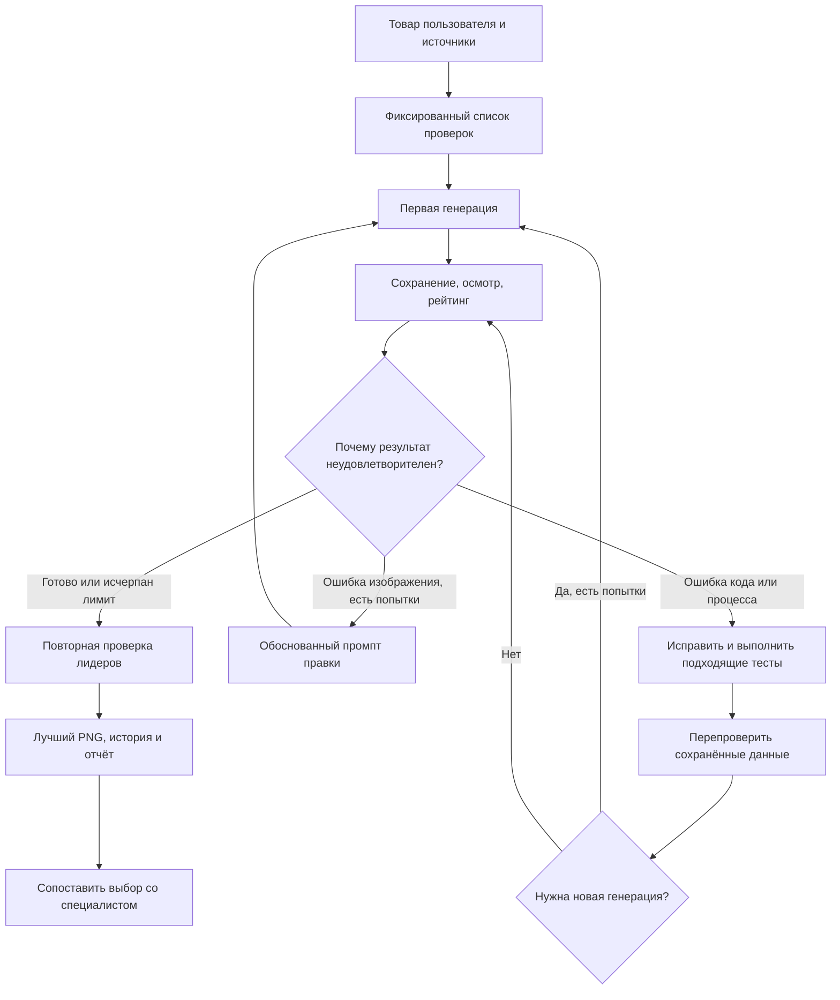

# План тестов и самостоятельного исправления

Статус: план и ориентир последующих проверок, 10 октября 2026 года. Выполнены 38 автоматических проверок механики и реальный пилот из 6 генераций AQUARIO; фактические результаты/ограничения находятся в [журнале v0.1](development-v0.1.md). Независимая экспертиза, другой класс товара и реальные параллельные чаты ещё не проверены. Ниже сохраняется полная программа испытаний.

## Что нужно для начала

Пользователь пришлёт один пилотный товар: достаточно ссылки на карточку с однозначной моделью. Codex сам попробует получить фотографию и документы производителя. Если карточка недоступна или модификация неоднозначна, потребуется уточнение; уже известная пользователю инструкция полезна, но не обязательна для начала.

Для пилота нужны доступные генерация/редактирование, просмотр изображений, поиск, файлы и среда для вспомогательных скриптов. Они проверяются до реальной генерации. Для предложенного встроенного исполнителя отдельно получать API-ключ пользователя не планируется; перенос на внешний API — отдельное решение.

Оценка технического специалиста нужна для проверки инженерного качества и калибровки рейтинга. Она не блокирует разработку и автоматические проверки кода, но без неё нельзя объявить подтверждённую экспертную точность. Достаточно его выбора лучшего варианта и замечаний к узлам, которые агент оценил неверно.

Размер PNG и папку результатов можно задать перед пилотом. Остальные технические настройки первоначально выбираются по примеру пользователя и фиксируются в профиле, чтобы их можно было изменить.

## 1. Проверки механики без генераций

Используются подготовленные данные и имитатор ответов генератора. Эти тесты не расходуют десять реальных попыток и не доказывают качество картинок.

| Проверка | Сценарий | Ожидаемый результат |
|---|---|---|
| Лимит | Запросить 11-ю попытку, в том числе после ошибки | Отказ; счётчик не сбрасывается |
| Сохранение | Результат есть, сохранение/процесс прерваны | Файл и состояние восстанавливаются без перезаписи готовых версий |
| Неизвестный исход | Вызов начат, ответ потерян | Явный статус; нет автоматического повторного вызова под тем же номером |
| Отдельные запуски | Два запуска одного артикула | Разные папки, независимые лимиты и истории |
| Конкуренция | Две операции над одним состоянием | Нет двойной выдачи одной попытки и повреждения файла |
| Рейтинг | Заданные статусы с известной суммой | Точный расчёт; неверные веса/ID/статусы отклоняются |
| Выбор | Красивый кандидат с критической ошибкой и менее красивый без неё | Побеждает вариант без критического противоречия |
| Источники | Факт из аналога в поле подтверждения модели | Ошибка формата/применимости; не начисляются баллы за документальное подтверждение |
| Изменение checklist | Правила обновлены после нескольких версий | Нельзя сравнить оценки разных редакций без переоценки |
| Оформление PNG | Кириллица, длинные подписи, края изображения | Текст сохранён, изображение открывается; геометрические конфликты выявлены |
| Правки | Переименовать подпись / изменить конструкцию | Первая правка пересобирает PNG без генерации при составном оформлении; вторая требует технической проверки |
| Итог | Последняя версия хуже предыдущей | Главной остаётся предыдущая; все версии и причины выбора сохранены |

Скрипты проверяются на реальных файлах, а не только по чтению кода. Структурный валидатор скилла проверяет упаковку; отдельно проверяется обнаружение и вызов скилла в целевом окружении.

## 2. Контрольные проверки технического оценщика

Проверка review.json тестирует арифметику. Для проверки распознавания агенту нужны сами картинки и основания, без подсказки ожидаемого вердикта.

- Проверить пример/вариант с известным расхождением: положение клапана, тип двигателя, число ступеней или невозможное соединение. Сначала подтвердить контрольный ответ по документу или специалисту.
- Проверить скрытый узел: агент должен отметить «не удалось проверить», а не объявить совпадение по одной подписи.
- Проверить красивый, но неверный вариант против менее эффектного, более правильного.
- Проверить неполную документацию: применение аналога остаётся реконструкцией, а не доказательством устройства целевой модели.
- Повторно оценить сохранённого лидера отдельными проходами, не выдавая прошлые баллы. Разобрать изменения вердиктов по критическим пунктам и изменение итогового выбора.

Для начала достаточно доступных сохранённых изображений, увеличенных областей и пользовательского примера. Новые изображения ради контрольного дефекта не генерируются автоматически. Если подходящего примера нет, такой тест честно отмечается как не выполненный, а не заменяется исключительно синтетическим JSON.

Пропущенная контрольная критическая ошибка — повод доработать проверяющий промпт, источники, разрез или перечень проверок и повторить тест. Нестабильный рейтинг — повод уточнить наблюдаемые признаки и частичные баллы. Численную допустимую погрешность оценки определим по пилоту; маленький разброс баллов сам по себе не доказывает верный выбор.

## 3. Реальный пилот на товаре пользователя

В пилоте проверяются весь путь от URL до выдачи в чат, настоящая генерация и редактирование, сохранение исходников и версий, рейтинг, краткий прогресс, раскрытие аналогов и выбор лучшего результата. Не требуется обязательно израсходовать десять попыток.

## 4. Codex исправляет ошибки самостоятельно

Во время сборки и пилота пользователь заранее разрешил исправлять код и архитектурные проблемы проекта без просьбы «пофикси». При сбое Codex:

1. Сохраняет воспроизводимый случай, ошибку, состояние и уже полученные изображения.
2. Определяет причину: код, получение/применимость источников, правило проверки, промпт, оформление или ограничения генератора.
3. Исправляет соответствующую часть. Для существенной ошибки кода добавляет регрессионную проверку, если она защищает важное поведение.
4. Выполняет затронутые тесты, затем возвращается к пилоту с сохранённого этапа.
5. Записывает исправление и результат проверки в журнал разработки.

Это не обещание исправить любой технический дефект картинки изменением кода. Ошибки генерации исправляются промптами/редактированием; отсутствие документации записывается как ограничение. Если гипотеза о причине не подтверждена, агент проверяет другую, а не выдаёт неуспешную правку за исправление.

Пересчёт рейтинга, просмотр существующих картинок, исправление скриптов и обычная сборка PNG не расходуют генерации. Новый вызов генератора/редактора расходует следующую попытку по принятому рабочему правилу. Исправление кода не обнуляет лимит 10. После исчерпания лимита сохраняются результаты и конкретная причина незавершённости; дополнительные генерации требуют отдельного решения о бюджете.

Это режим разработки и пилотирования. Обычный будущий запуск скилла обрабатывает товар и правки; самостоятельное переписывание установленного скилла в каждом рабочем запуске не закладывается.

## 5. После первого товара

Проверить последующую правку пользователя и возобновление. Затем проверить другой класс товара, чтобы исключить зашитую конструкцию насоса. Для проверки изоляции достаточно имитированных параллельных запусков; несколько реальных генераций одновременно проверяются при переходе к многотоварному режиму.

Результаты фиксируются как «пройдено / не пройдено / не проверено» с файлами и основаниями. До реального пилота никаких заявлений о пройденных инженерных тестах не делается.
