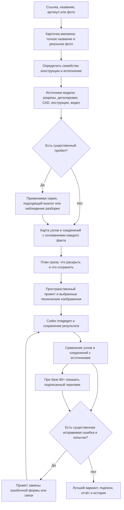

# Универсальный скилл: конструкция из источников, а не шаблон AQUARIO

Обновление инструкций — 13 октября 2026 года. Цель: пользователь передаёт ссылку, название, артикул или картинку; агент самостоятельно находит карточку 477477.ru и готовит учебный разрез. Ручные подсказки о внутренних узлах и обязательный пользовательский референс не являются частью штатного запуска. Вопрос нужен при неразрешимой идентификации/модификации, а не для передачи пользователю работы исследователя.

## Полный маршрут

Подписи и история выполняются существующими скриптами. Максимум нового раунда — пять вызовов. Отсутствие источника не лечится повторной генерацией. Если доступна только реконструкция по аналогу, агент стремится показать полный функциональный механизм и явно описывает её границы в соседнем отчёте.

## Подготовка вместо перечня названий

Создаётся `input/construction-plan.md`: узлы, вложенность, форма и число, сопряжения, физические каналы, перегородки/уплотнения, расположение, назначение, план среза и сохраняемые внешние признаки. Каждое существенное утверждение связано с конкретной страницей, выбранным видом 3D или просмотренным кадром видео. Числовые размеры не придумываются.

Генератор получает изображения и конкретные инструкции: «А находится внутри Б», «В охватывает Г», «Д соединяется с Е через такое отверстие», «эта перегородка разделяет камеры», «открыть здесь, чтобы было видно сопряжение». Файлы/URL сами по себе не заменяют извлечённое описание. Процедура добавлена в [инструкции скилла](../.agents/skills/product-cutaway-agent/references/construction-plan.md).

Семейства нужны для поиска и выбора представления: насос/машина, клапан/регулятор, фильтр/слои, теплообменник/нагреватель, сосуд, фитинг/труба, другие механизмы. Это не готовые списки деталей. Трубе не добавляется двигатель, фильтру — насос без источника, простому фитингу — искусственно сложный механизм. Срез выбирается по конструкции, включая выборочные окна или послойную схему.

Источники дополняют друг друга: инструкция устанавливает принцип и материалы; деталировка — видимые состав и порядок; внутренний CAD — форму и сопряжения; просмотренная разборка — конкретное наблюдение. Наружный BIM не раскрывает скрытые детали. Для видео сохраняются автор, точная модель, таймкод и наблюдение; описание/субтитры не равны визуальному осмотру. Просмотр определяется реальными инструментами и не обещается для каждого видео. Сторонние наблюдения сохраняют происхождение и ограничения.

## Почему нынешние баллы недостаточны

Скрипт проверяет структуру данных и складывает баллы; он не узнаёт детали на изображении. Агент может составить слишком мягкую проверку, принять условную форму за точную или не заметить ошибку. Повторная проверка тем же агентом не становится независимой экспертизой. Правильная арифметика не устраняет эти ошибки.

Инструкции усилены: сверять различимые формы и реальные сопряжения, а не название/наличие похожего блока; скрытый механизм не считать доказанным; описывать конкретное совпадение или конфликт с источником. Заключение начинается с подтверждённых признаков, противоречий и реконструкций. Баллы остаются диагностикой checklist, а не процентом точности; прежние 91 не объявлены подтверждённой конструкцией.

Пока сохранены код расчёта, веса, порядок выбора и порог 80 для подписей. Изменение — отдельная реализация после проверки на нескольких семействах. Нельзя незаметно изменить формулу, назвать новую оценку объективной или пересчитать прежний пилот без новой версии критериев и осмотра изображений.

Следующий протокол проверяется по способности выявлять существенные ошибки и пропуски. Для пользователя главное: какие важные признаки совпали с источником, какие противоречат ему и какие остаются реконструкцией. Если сохранять агрегированное число, его правила должны быть откалиброваны по таким результатам. Цель 90–95 сама по себе не определяет готовность.

## Программа проверки универсальности

Следующие испытания ещё не выполнены:

1. Агент сам выбирает товары магазина из разных семейств, без пользовательских референсов. Включить точный разрез, взрыв-схему без сечения, наружный CAD, текстовую инструкцию и обоснованную аналоговую реконструкцию. Выбор определяется реально доступными карточками и источниками.
2. Проверить полный путь: модификация, фотография из магазина, карта конструкции, пространственный промпт, источники, итог без переноса узлов AQUARIO.
3. Проверить оценщик на контролируемых ошибках: неверный механизм/число/соединение, отсутствующее уплотнение, гладкий заместитель раскрытой детали. Вместе с ними использовать корректные варианты для обнаружения ложных отказов. Условные схемы не заменяют проверку настоящих генераций.
4. Проверить неполные данные: наличие узла известно, форма нет; аналог похож снаружи, но работает иначе; видео недоступно; документы ревизий конфликтуют. Различать факт, противоречие и реконструкцию, а не выдавать всё за совпадение.
5. После настройки проверить другие товары, не использованные для настройки. Зафиксировать дефекты по узлам, исправления и расход времени/попыток. Технический специалист проверяет выборку для калибровки оценщика и результаты перед размещением, а не пишет промпты к каждому товару.

Первый пилот полезен для регрессий, но не доказывает работу на 30 тысячах позиций. Семейства и источники можно кешировать; новый артикул требует проверки исполнения. Массовый планировщик задач, универсальное автоматическое чтение CAD/видео и независимый визуальный оценщик этими изменениями не созданы.

## Фактически сделано

- Обновлены инструкции: вход по фото, самостоятельное исследование, обязательная карта конструкции, представление по механизму.
- Добавлен универсальный шаблон пространственного промпта; пользовательский референс необязателен.
- Уточнены источники/видео/аналоги и правила наблюдений; узкие примеры исправления бака убраны из общего промпта.
- Сохранены совместимость скриптов, пять попыток, подписи при 80+ и исторические результаты.
- Новых изображений и испытаний других семейств в этом изменении нет. Надёжность пересмотренного процесса предстоит измерить.
