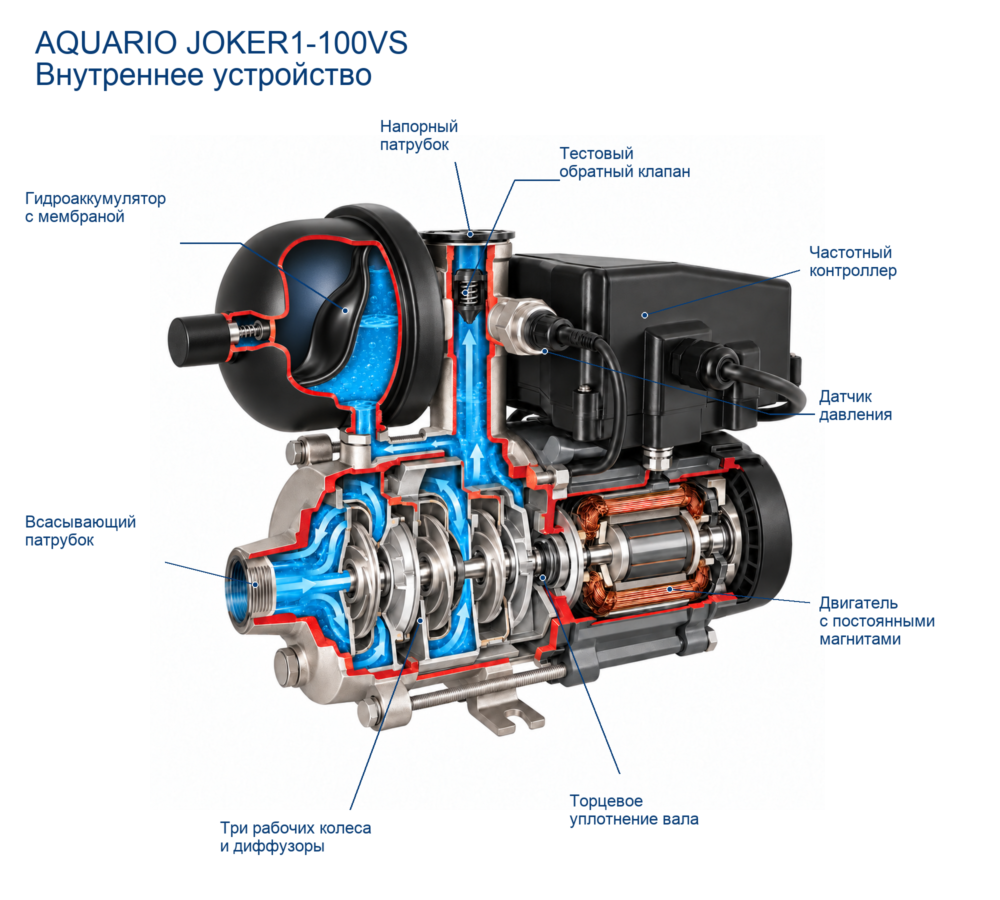

# AQUARIO JOKER1-100VS: итог пилота

Лучший вариант: **6**, рейтинг **92/100**.
Рейтинг сравнивает варианты, а не измеряет вероятность технической правильности.
Попытки: 6/10. Причина остановки: После 6 попыток выбран лучший доступный вариант. Новая геометрия каналов не стала проверяемой; продолжение без более подробной схемы не обосновано. T1 остаётся непроверенным; нужна оценка специалиста..
Технический специалист ещё не подтвердил результат.

## Проверка выбранного варианта

- Конструкция: 45/45.
- Расположение и связи: 17/25.
- Функциональная полнота: 15/15.
- Внешнее сходство: 10/10.
- Ясность и выноски: 5/5.

Критические противоречия: не обнаружены в проведённой проверке.
Непроверенные критические пункты: T1.
- T1 (unknown): Повторный осмотр не установил однозначную непрерывную последовательную связь всех возвратных каналов; пункт остаётся unknown, а не автоматически pass из-за высокого общего балла.

## Основания и реконструкция

- model: Гидравлическая часть, три рабочих колеса, Синхронный двигатель с постоянными магнитами, Частотный контроллер, Датчик давления, Гидроаккумулятор с мембраной EPDM, Тестовый обратный клапан в выходном патрубке, Торцевое уплотнение вала.
- series: нет.
- analog: Показанное внутреннее устройство колёс и диффузоров, Показанная форма мембраны и камер.
- unknown: нет.
- Ограничение: Заводская инструкция не содержит полного внутреннего разреза, размеров рабочих колёс, точной формы мембраны и каналов.
- Ограничение: Количество/геометрия магнитов и обмоток, подшипники, внутренняя плата контроллера не установлены этой инструкцией; изображение этих деталей схематично.
- Ограничение: Редакция 10.2024 указывает 3 ступени; некоторые карточки магазинов указывают 5. Фактическую ревизию экземпляра следует проверить специалисту.
- Ограничение: Тестовый выходной клапан не заменяет требуемый инструкцией внешний клапан всасывающей магистрали; внешняя магистраль в этом изображении не показана.
- Реконструкция по аналогам: ESPA, стр.67: последовательность колеса/диффузора и отделение двигателя уплотнением использованы для учебной реконструкции геометрии.
- Реконструкция по аналогам: Caleffi, стр.2: разделение газовой и водяной камер мембраной использовано как принцип, без копирования размеров/материалов/формы другого бака.

## История вариантов

| Версия | Рейтинг | Критические ошибки | Замечания и исправления |
|---|---:|---|---|
| 1 | 73 | T3 | Золотистые колёса; бак визуально подключён к началу гидравлики. Межступенчатый путь и воздушный канал непроверены. Дополнительно клапан выглядит металлическим, хотя в инструкции указан PPO/NBR. |
| 2 | 80 | T3, T4 | Колёса исправлены на серебристые, клапан стал полимерным. Воздушный ниппель после правки соединён с водяной камерой; подключение бака и серийность каналов по-прежнему проблемны. Исправлено: Серебристые рабочие колёса; Чёрный полимерный клапан вместо золотистого |
| 3 | 86 | — | Исправлены серебристые колёса, материал клапана и видимая напорная ветвь бака. Мембрана перенесена относительно воздушного ниппеля. Серийный возврат между ступенями ещё не читается однозначно. Повторная проверка сняла баллы за неоднозначное газовое подключение. Исправлено: Отдельная напорная ветвь к водяной камере бака; Изменена граница мембраны у воздушного ниппеля |
| 4 | 86 | — | Возвратные области ступеней показаны подробнее. Непрерывная последовательная гидравлика остаётся непроверенной; добавление стрелок само по себе не исправляет этот пункт. Повторная проверка сняла баллы за неоднозначное газовое подключение. Исправлено: Больше видимых областей межступенчатых каналов |
| 5 | 68 | — | Другой разрез выглядит чище, но потеряны видимые магнитные вставки и напорная ветвь бака; газовое подключение не доказано, пропорции изменились. Выноски исправлены без нового вызова генератора. Исправлено: Более спокойное оформление воды без многочисленных стрелок; Исправлены координаты выносок для широкого изображения |
| 6 | 92 | — | Лучше всего разделены газ и вода в баке; видна напорная ветвь, три серебристых колеса, клапан на выходе и отдельный контроллер. Последовательная связь возвратных каналов остаётся непроверенной. Повторный итоговый проход сохранил оценку и непроверенность T1. Исправлено: Мембрана отделяет ниппель от водяной камеры без пограничного положения |

## Источники

- [AQUARIO JOKER1-100VS, редакция 10.2024](https://aquario.ru/sites/default/files/manuals/Joker_0.pdf): manufacturer_model; Точная модель; PDF страницы 5/6/9/12/13, печатные 3/4/7/10/11. Схема, таблица и нужные разделы осмотрены.
- [Фотография товара, предоставленная пользователем](https://477477.ru/catalog/nasosy/aquario-2700): product_photo; Пользователь приложил фото этой карточки; прямое получение страницы вернуло 403. Не утверждаем самостоятельное скачивание с магазина.
- [ESPA TECNOPLUS, схема основных компонентов, страница 67](https://www.espa.com/download/docs/6254/instruction-manual-espa-tecnoplus-25.pdf): analog; Только взаимное устройство рабочего колеса, диффузора, общего вала и торцевого уплотнения многоступенчатого центробежного насоса. Число ступеней, самовсасывание, двигатель/конденсатор и размеры не переносятся.
- [Caleffi 01079/01: принцип мембранного сосуда, страница 2](https://www.caleffi.com/sites/default/files/media/external-file/01079_EN_20.pdf): analog; Только разделение газа и воды мембраной. Форма бака, объём, материал мембраны, точная форма крепления и режим работы этих моделей не переносятся.
