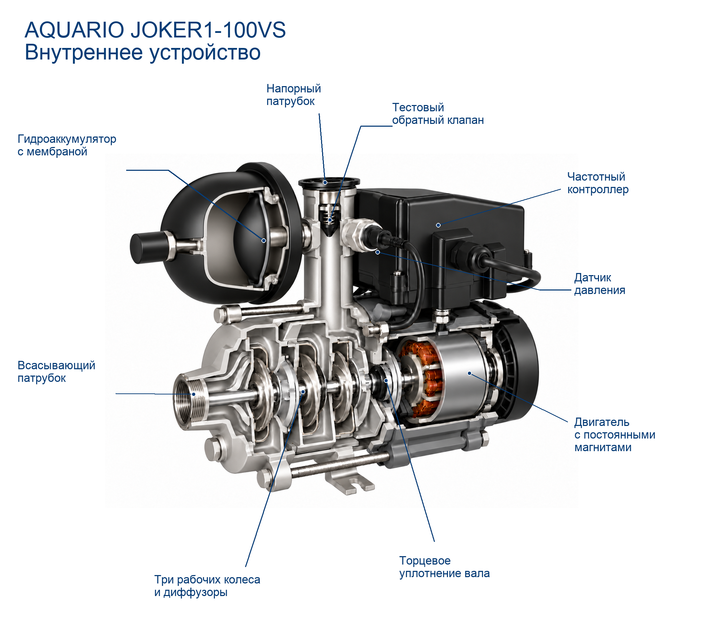

# AQUARIO JOKER1-100VS: итог пилота

Лучший вариант: **9**, рейтинг **92/100**.
Рейтинг сравнивает варианты, а не измеряет вероятность технической правильности.
Попытки: 9/10. Причина остановки: Цель диапазона90–95 достигнута по текущему checklist:92. Все наблюдаемые критические противоречия устранены; T1 остаётся непроверенным.9/10 попыток, включая прерванную8; одна не использована, поскольку дополнительная точная геометрия каналов не подтверждена. Дальнейшая генерация без новых доказательств не даёт основания объявлять100..
Технический специалист ещё не подтвердил результат.

## Проверка выбранного варианта

- Конструкция: 45/45.
- Расположение и связи: 17/25.
- Функциональная полнота: 15/15.
- Внешнее сходство: 10/10.
- Ясность и выноски: 5/5.

Критические противоречия: не обнаружены в проведённой проверке.
Непроверенные критические пункты: T1.
- T1 (unknown): Виден вход, три ступени и выход, но по физическим отверстиям этого сечения невозможно уверенно проследить весь последовательный переход между всеми ступенями. Заводская деталировка не раскрывает полный маршрут каналов. Баллы не начисляются.

## Основания и реконструкция

- model: Гидравлическая часть, три рабочих колеса, Синхронный двигатель с постоянными магнитами, Частотный контроллер, Датчик давления, Гидроаккумулятор с мембраной EPDM, Тестовый обратный клапан в выходном патрубке, Торцевое уплотнение вала, Геометрия колёс и диффузоров по заводской 3D-деталировке.
- series: нет.
- analog: Показанная форма мембраны и камер.
- unknown: нет.
- Ограничение: Количество/геометрия магнитов и обмоток, подшипники, внутренняя плата контроллера не установлены этой инструкцией; изображение этих деталей схематично.
- Ограничение: Редакция 10.2024 указывает 3 ступени; некоторые карточки магазинов указывают 5. Фактическую ревизию экземпляра следует проверить специалисту.
- Ограничение: Тестовый выходной клапан не заменяет требуемый инструкцией внешний клапан всасывающей магистрали; внешняя магистраль в этом изображении не показана.
- Ограничение: Новая заводская 3D-деталировка показывает компоненты/чашеобразный вал-ротор, но не доказывает всю геометрию скрытых межступенчатых каналов и мембраны.
- Ограничение: Нельзя считать наружную чашу ротора длинным цилиндрическим внутренним ротором; точная форма магнитных сегментов не измерена.
- Ограничение: Утверждённый пользователем пример одобрен по внешнему виду, без технической экспертизы. Из 3D виден целый бак, его точная мембрана и субстрат корпуса не раскрыты.
- Ограничение: Новый ракурс3D раскрывает оранжевые обмотки статора и чашку ротора; детали магнитных сегментов/полная скрытая посадка ещё требуют проверки конкретного рисунка.
- Реконструкция по аналогам: Caleffi, стр.2: разделение газовой и водяной камер мембраной использовано как принцип, без копирования размеров/материалов/формы другого бака.
- Реконструкция по аналогам: ESPA теперь используется только как дополнительный принцип серийного прохождения, а геометрию пакета следует брать из AQUARIO 3D; мембрана всё ещё реконструкция по принципу Caleffi.

## История вариантов

| Версия | Рейтинг | Критические ошибки | Замечания и исправления |
|---|---:|---|---|
| 1 | 78 | T3, L2 | Бак визуально ближе к утверждённому примеру: гладкая мембрана и закрытый ниппель, красные полосы устранены. Потерялась проверяемость камерных связей и остался искусственный узор; баллы не повышаются за внешнее сходство. Повторная оценка по новому ракурсу: нижняя ветвь бака противоречит заводскому заднему присоединению. Прежняя неопределённость T3 заменена наблюдаемым fail, история сохранена. Дополнительное сопоставление C2 с новым задним ракурсом подтвердило общую компоновку; прежняя проверка сохранена. Исправлено: Убраны красные/цветные полосы на всех срезах; Складчатая мембрана заменена гладкой; Ниппель закрыт, выдуманный открытый пружинный картридж убран |
| 2 | 73 | C3, T3, L2 | Крепление мембраны и короткое газовое отверстие стали яснее, однако правка удалила выходной клапан. Текстура не исправлена; связь водяной камеры и межступенчатые каналы непроверены. Повторная оценка по новому ракурсу: нижняя ветвь бака противоречит заводскому заднему присоединению. Прежняя неопределённость T3 заменена наблюдаемым fail, история сохранена. Дополнительное сопоставление C2 с новым задним ракурсом подтвердило общую компоновку; прежняя проверка сохранена. Исправлено: Гладкая мембрана получила видимое краевое крепление; Открыто короткое отверстие газового ниппеля без пружинного картриджа |
| 3 | 84 | T3, L2 | Выходной клапан восстановлен без новой потери узлов; мембрана гладкая, ниппель без пружинного картриджа. Узор и неоднозначная связь водяной камеры остаются; каналы и посадка двигателя также непроверены. Повторная оценка по новому ракурсу: нижняя ветвь бака противоречит заводскому заднему присоединению. Прежняя неопределённость T3 заменена наблюдаемым fail, история сохранена. Дополнительное сопоставление C2 с новым задним ракурсом подтвердило общую компоновку; прежняя проверка сохранена. Исправлено: Восстановлен тестовый выходной клапан; Поверхность контроллера стала спокойнее; полного удаления узора нет |
| 4 | 81 | T3, L2 | Выходной клапан восстановлен без новой потери узлов; мембрана гладкая, ниппель без пружинного картриджа. Узор и неоднозначная связь водяной камеры остаются; каналы и посадка двигателя также непроверены. Повторная оценка по новому ракурсу: нижняя ветвь бака противоречит заводскому заднему присоединению. Прежняя неопределённость T3 заменена наблюдаемым fail, история сохранена. Дополнительное сопоставление C2 с новым задним ракурсом подтвердило общую компоновку; прежняя проверка сохранена. Исправлено: Восстановлен тестовый выходной клапан; Поверхность контроллера стала спокойнее; полного удаления узора нет |
| 5 | 90 | L2 | Заднее подключение и функциональные узлы соответствуют наблюдаемым требованиям; орнамент на корпусах остаётся. Маршрут межступенчатых каналов не проверен. Исправлено: Исправлена нижняя ветвь бака на заднее горизонтальное подключение |
| 6 | 90 | L2 | Локальная правка поверхности не испортила узлы и задний порт, но не полностью убрала повторяющийся орнамент. Исправлено: Контроллер и внешняя сторона бака стали более гладкими |
| 7 | 90 | L2 | Заново отрисованные гладкие поверхности существенно чище; остаток узора находится внутри бака. Исправлено: Удалён явный узор с основных металлических поверхностей и чёрного кожуха двигателя |
| 8 | — | — | unknown: Вызов image_gen был прерван пользователем до ответа; в папке результатов этой задачи после проверки 2026-10-11 новый PNG отсутствует. Не исключено серверное выполнение; вызов засчитан в бюджет, повтор под номером8 не делается. |
| 9 | 92 | — | Сухой разрез с гладкой тонкой мембраной и задним горизонтальным подключением бака; три ступени, выходной клапан, двигатель, датчик и контроллер сохранены. Орнамент и цветная обводка отсутствуют. Полная серийная связь каналов остаётся unknown. Исправлено: Удалён остаточный узор внутри бака; Сохранено правильное заднее присоединение и все функциональные узлы |

## Источники

- [AQUARIO JOKER1-100VS, редакция 10.2024](https://aquario.ru/sites/default/files/manuals/Joker_0.pdf): manufacturer_model; Точная модель; PDF страницы 5/6/9/12/13, печатные 3/4/7/10/11. Схема, таблица и нужные разделы осмотрены.
- [Фотография товара, предоставленная пользователем](https://477477.ru/catalog/nasosy/aquario-2700): product_photo; Пользователь приложил фото этой карточки; прямое получение страницы вернуло 403. Не утверждаем самостоятельное скачивание с магазина.
- [ESPA TECNOPLUS, схема основных компонентов, страница 67](https://www.espa.com/download/docs/6254/instruction-manual-espa-tecnoplus-25.pdf): analog; Только взаимное устройство рабочего колеса, диффузора, общего вала и торцевого уплотнения многоступенчатого центробежного насоса. Число ступеней, самовсасывание, двигатель/конденсатор и размеры не переносятся.
- [Caleffi 01079/01: принцип мембранного сосуда, страница 2](https://www.caleffi.com/sites/default/files/media/external-file/01079_EN_20.pdf): analog; Только разделение газа и воды мембраной. Форма бака, объём, материал мембраны, точная форма крепления и режим работы этих моделей не переносятся.
- [AQUARIO factory exploded 3D: JOKER1-100VS / 2700](https://aquario.ru/3d-diagrams): manufacturer_model; Exact 2700 selected in https://aquario.ru:1111/user/pubscheme; inspected named rotor 8036 (cup-shaped), impeller 8039 (3), diffuser assembly and parts list. Shows component form/placement, not a complete sectional water path or cut diaphragm. 2026-10-10 new rotated rear/reverse views: accumulator rear central horizontal coupling aligned with the side port of pressure tee; tank not connected through its bottom. Rear face of stator reveals copper/orange winding ring facing the cup-shaped rotor. Exact diaphragm and passages remain unverified.
- [Пользовательский утверждённый визуальный пример](/Users/nikitas/Documents/ChatGPT/Ворк/plumbing-detailing-/pilot/aquario-joker1-100vs/20261010T103041Z-858f303a/input/approved-reference.jpg): style_reference; Утверждён по внешнему виду (ответ пользователя). Форма раскрытия бака и гладкой мембраны — визуальный ориентир; не источник заводской геометрии, количества ступеней или положения клапана. Воду и красные срезы из него не переносить.
