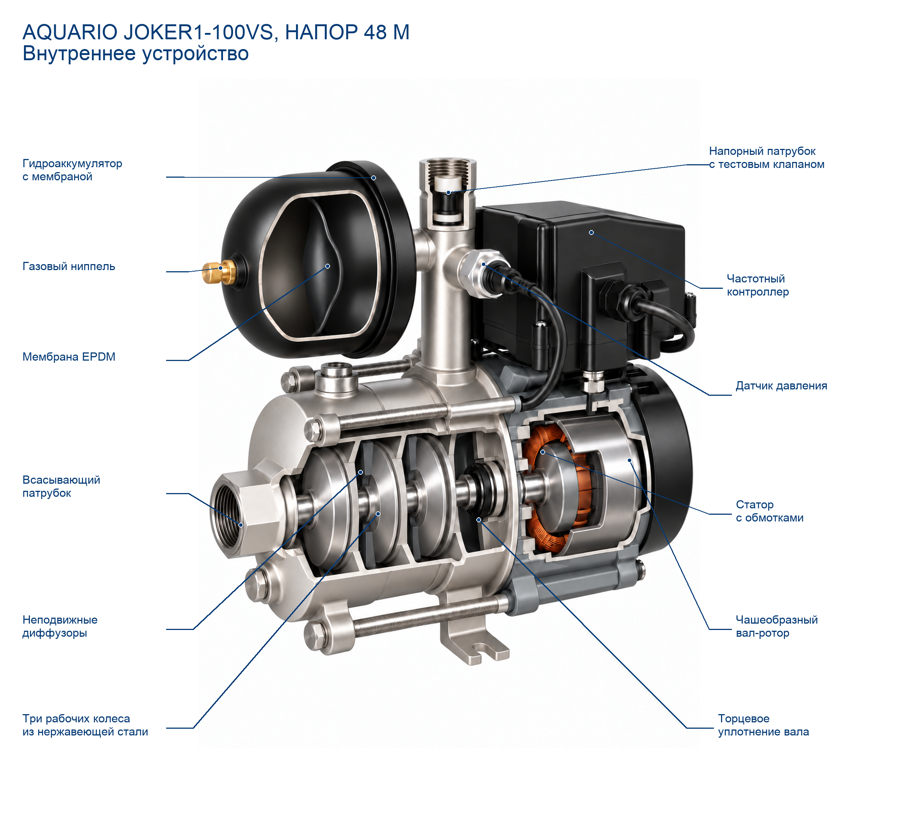

# AQUARIO JOKER1-100VS: итог пилота

Лучший вариант: **5**, рейтинг **91/100**.
Рейтинг сравнивает варианты, а не измеряет вероятность технической правильности.
Попытки: 5/5. Причина остановки: Selected5 after whole-frame/source and caption checks; dry image with natural sections, correct cup/stator arrangement and three discs. Full rating91 includes5caption points; raw86. Unknown9source points remain; technical review needed. Five requests preserved: first send failed, fourPNG generated through ordinary ChatGPT Images..
Технический специалист ещё не подтвердил результат.

## Проверка выбранного варианта

- Конструкция: 37/45.
- Расположение и связи: 24/25.
- Функциональная полнота: 15/15.
- Внешнее сходство: 10/10.
- Ясность и выноски: 5/5.
- Этап оценки: captioned; разрез без подписей: 86/100.
Баллы, добавленные за подписи, не означают улучшение внутренней конструкции.

Критические противоречия: не обнаружены в проведённой проверке.
Непроверенные критические пункты: нет.
- motor-material (unknown): Справа открыт мотор: длинная центральная цилиндрическая вращающаяся часть внутри наружных обмоток. Вал общий, опорные кольца видны. Заводская отдельная тонкостенная чашка8036 с посадкой относительно8044 не воспроизведена; постоянные магниты не различимы. Точный аспект не установлен источниками: Паспорт не задаёт точные марки материалов магнитов и обмотки; цвет 3D не доказывает материал.
- controller-material (unknown): Один закрытый чёрный прямоугольный блок сверху мотора с нижней монтажной частью; провода и вводы сохранены. Внутренняя плата не дорисована. Точный аспект не установлен источниками: Точный полимер корпуса и материалы внутренних элементов не установлены.
- sensor-material (unknown): Один цилиндрический датчик с шестигранным основанием ввинчен в боковую напорную ветвь; кабель идёт к контроллеру. Точный аспект не установлен источниками: Точные материалы корпуса/чувствительного элемента не названы в осмотренном паспорте.
- tank-shape (unknown): Один бак с передним газовым ниппелем, простой тёмной мембраной и пустыми камерами. Задний горизонтальный штуцер соединяет бак со стояком, нижнего водяного ответвления нет. Форма и прижим мембраны в заводских источниках не раскрыты. Точный аспект не установлен источниками: Заводская3D показывает бак целиком; точная форма мембраны и камер не раскрыта.
- tank-attachment (unknown): Один бак с передним газовым ниппелем, простой тёмной мембраной и пустыми камерами. Задний горизонтальный штуцер соединяет бак со стояком, нижнего водяного ответвления нет. Форма и прижим мембраны в заводских источниках не раскрыты. Точный аспект не установлен источниками: Заводская3D не раскрывает точное крепление мембраны в корпусе бака.

## Состояние результата

Нужна техническая проверка: существенные признаки не подтверждены.
Основания статуса: motor-material, controller-material, sensor-material, tank-shape, tank-attachment.
Этот статус не означает одобрение специалистом или разрешение публикации.

## Подтверждение отдельных признаков

Счётчики относятся к существенным внутренним признакам, а не к проценту достоверности всего изделия. Потолок баллов учитывает весь checklist.
- Основание model: 30 (hydraulic-type_count, hydraulic-shape, hydraulic-attachment, hydraulic-placement_connections, hydraulic-material, motor-type_count, motor-shape, motor-attachment, motor-placement_connections, controller-type_count, controller-shape, controller-attachment, controller-placement_connections, sensor-type_count, sensor-shape, sensor-attachment, sensor-placement_connections, tank-type_count, tank-placement_connections, tank-material, valve-type_count, valve-shape, valve-attachment, valve-placement_connections, valve-material, seal-type_count, seal-shape, seal-attachment, seal-placement_connections, seal-material).
- Основание series: 0 (нет).
- Основание analog: 0 (нет).
- Основание unknown: 5 (motor-material, controller-material, sensor-material, tank-shape, tank-attachment).
- Совпадение изображения с основанием model: 30 (hydraulic-type_count, hydraulic-shape, hydraulic-attachment, hydraulic-placement_connections, hydraulic-material, motor-type_count, motor-shape, motor-attachment, motor-placement_connections, controller-type_count, controller-shape, controller-attachment, controller-placement_connections, sensor-type_count, sensor-shape, sensor-attachment, sensor-placement_connections, tank-type_count, tank-placement_connections, tank-material, valve-type_count, valve-shape, valve-attachment, valve-placement_connections, valve-material, seal-type_count, seal-shape, seal-attachment, seal-placement_connections, seal-material).
- Совпадение изображения с основанием series: 0 (нет).
- Совпадение изображения с основанием analog: 0 (нет).
- unverified: motor-material, controller-material, sensor-material, tank-shape, tank-attachment.
- contradicted: нет.
- partial: нет.
Недоступные по текущим источникам баллы: 9; пункты: motor-material, controller-material, sensor-material, tank-shape, tank-attachment.
Потолок по имеющимся основаниям: 91/100. Это не обещание получить данный балл.

| Пункт | Узел / признак | Основание | Статус | Источник / локатор | Сопоставление |
|---|---|---|---|---|---|
| hydraulic-type_count | hydraulic / type_count | model | pass | aquario-manual: PDF5/6/9 (печатные3/4/7) | Повторный осмотр всего PNG5 и узлов по текущим замороженным фактам: Полный повторный осмотрPNG4: Повторный полный осмотр PNG3: Повторный осмотр всего новогоPNG2: Паспорт: три центробежных рабочих колеса. Сопоставление с PNG: Три серебристых колеса на общем валу, видны диффузоры и четыре продольные стяжки. Вход слева; за последней ступенью камера под верхним выходом. Полные скрытые каналы не подтверждены. |
| hydraulic-shape | hydraulic / shape | model | pass | aquario-3d: Заводская2700: передний/обратный ракурсы, список деталей | Повторный осмотр всего PNG5 и узлов по текущим замороженным фактам: Полный повторный осмотрPNG4: Сопоставление с крупными заводскими видами и сухой политикой: Три дискообразных металлических колеса с закрытыми наружными профилями/ступенчатыми бортами и неподвижными межступенчатыми стенками вместо придуманных открытых спиц. Общий профиль сопоставлен с крупной3D; скрытые лопатки/каналы не утверждаются. |
| hydraulic-attachment | hydraulic / attachment | model | pass | aquario-3d: Заводская2700: передний/обратный ракурсы, список деталей | Повторный осмотр всего PNG5 и узлов по текущим замороженным фактам: Полный повторный осмотрPNG4: Повторный полный осмотр PNG3: Повторный осмотр всего новогоPNG2: Входной фланец и задний диффузор стянуты четырьмя продольными винтами. Сопоставление с PNG: Три серебристых колеса на общем валу, видны диффузоры и четыре продольные стяжки. Вход слева; за последней ступенью камера под верхним выходом. Полные скрытые каналы не подтверждены. |
| hydraulic-placement_connections | hydraulic / placement_connections | model | pass | aquario-3d: Заводская2700: передний/обратный ракурсы, список деталей | Повторный осмотр всего PNG5 и узлов по текущим замороженным фактам: Полный повторный осмотрPNG4: Повторный полный осмотр PNG3: Повторный осмотр всего новогоPNG2: Спереди вход, сзади гидропакета выход в верхний напорный стояк; точные скрытые каналы не раскрыты. Сопоставление с PNG: Три серебристых колеса на общем валу, видны диффузоры и четыре продольные стяжки. Вход слева; за последней ступенью камера под верхним выходом. Полные скрытые каналы не подтверждены. |
| hydraulic-material | hydraulic / material | model | pass | aquario-manual: PDF5/6/9 (печатные3/4/7) | Повторный осмотр всего PNG5 и узлов по текущим замороженным фактам: Полный повторный осмотрPNG4: Повторный полный осмотр PNG3: Повторный осмотр всего новогоPNG2: Паспорт: рабочие колёса, диффузоры и вал — нержавеющая сталь. Сопоставление с PNG: Три серебристых колеса на общем валу, видны диффузоры и четыре продольные стяжки. Вход слева; за последней ступенью камера под верхним выходом. Полные скрытые каналы не подтверждены. |
| motor-type_count | motor / type_count | model | pass | aquario-manual: PDF5/6/9 (печатные3/4/7) | Повторный осмотр всего PNG5 и узлов по текущим замороженным фактам: Полный повторный осмотрPNG4: Сопоставление с крупными заводскими видами и сухой политикой: Тёмные магнитные элементы на внутреннем поясе чашки и отдельная неподвижная часть с обмоткой; соответствует документированномуPM, число магнитов не оценивается. |
| motor-shape | motor / shape | model | pass | aquario-3d: Заводская2700: передний/обратный ракурсы, список деталей | Повторный осмотр всего PNG5 и узлов по текущим замороженным фактам: Полный повторный осмотрPNG4: Сопоставление с крупными заводскими видами и сухой политикой: Широкая тонкостенная чашка с дном, валом и выборочным окном охватывает внутренний узел, форма соответствует выбранной8036. |
| motor-attachment | motor / attachment | model | pass | aquario-3d: Заводская2700: передний/обратный ракурсы, список деталей | Повторный осмотр всего PNG5 и узлов по текущим замороженным фактам: Полный повторный осмотрPNG4: Повторный полный осмотр PNG3: Повторный осмотр всего новогоPNG2: 3D: вал-ротор соосен пакету и установлен между опорами двигателя. Сопоставление с PNG: Справа открыт мотор: длинная центральная цилиндрическая вращающаяся часть внутри наружных обмоток. Вал общий, опорные кольца видны. Заводская отдельная тонкостенная чашка8036 с посадкой относительно8044 не воспроизведена; постоянные магниты не различимы. |
| motor-placement_connections | motor / placement_connections | model | pass | aquario-3d: 2700: увеличенные передний/обратный ракурсы8036/8044, осмотр13.10.2026 | Повторный осмотр всего PNG5 и узлов по текущим замороженным фактам: Полный повторный осмотрPNG4: Сопоставление с крупными заводскими видами и сухой политикой: В окне большой чашки видна внутренняя неподвижная часть статора с обмоткой; передний пояс обмотки у открытого торца, общий вал соосен. Это совпадает с обратной3D, малого ротора внутри огромного внешнего кольца меди больше нет. |
| motor-material | motor / material | unknown | unknown | aquario-manual: PDF5/6/9 (печатные3/4/7) | Повторный осмотр всего PNG5 и узлов по текущим замороженным фактам: Полный повторный осмотрPNG4: Повторный полный осмотр PNG3: Повторный осмотр всего новогоPNG2: Паспорт не задаёт точные марки материалов магнитов и обмотки; цвет 3D не доказывает материал. Сопоставление с PNG: Справа открыт мотор: длинная центральная цилиндрическая вращающаяся часть внутри наружных обмоток. Вал общий, опорные кольца видны. Заводская отдельная тонкостенная чашка8036 с посадкой относительно8044 не воспроизведена; постоянные магниты не различимы. Точный аспект не установлен источниками: Паспорт не задаёт точные марки материалов магнитов и обмотки; цвет 3D не доказывает материал. |
| controller-type_count | controller / type_count | model | pass | aquario-manual: PDF5/6/9 (печатные3/4/7) | Повторный осмотр всего PNG5 и узлов по текущим замороженным фактам: Полный повторный осмотрPNG4: Повторный полный осмотр PNG3: Повторный осмотр всего новогоPNG2: Паспорт: частотный контроллер управления по датчику давления. Сопоставление с PNG: Один закрытый чёрный прямоугольный блок сверху мотора с нижней монтажной частью; провода и вводы сохранены. Внутренняя плата не дорисована. |
| controller-shape | controller / shape | model | pass | aquario-3d: Заводская2700: передний/обратный ракурсы, список деталей | Повторный осмотр всего PNG5 и узлов по текущим замороженным фактам: Полный повторный осмотрPNG4: Повторный полный осмотр PNG3: Повторный осмотр всего новогоPNG2: 3D/паспорт: прямоугольный блок сверху двигателя; плата в базе не раскрывается. Сопоставление с PNG: Один закрытый чёрный прямоугольный блок сверху мотора с нижней монтажной частью; провода и вводы сохранены. Внутренняя плата не дорисована. |
| controller-attachment | controller / attachment | model | pass | aquario-3d: Заводская2700: передний/обратный ракурсы, список деталей | Повторный осмотр всего PNG5 и узлов по текущим замороженным фактам: Полный повторный осмотрPNG4: Повторный полный осмотр PNG3: Повторный осмотр всего новогоPNG2: 3D: корпус контроллера установлен над мотором на монтажной части. Сопоставление с PNG: Один закрытый чёрный прямоугольный блок сверху мотора с нижней монтажной частью; провода и вводы сохранены. Внутренняя плата не дорисована. |
| controller-placement_connections | controller / placement_connections | model | pass | aquario-3d: Заводская2700: передний/обратный ракурсы, список деталей | Повторный осмотр всего PNG5 и узлов по текущим замороженным фактам: Полный повторный осмотрPNG4: Повторный полный осмотр PNG3: Повторный осмотр всего новогоPNG2: Паспорт: кабельный ввод питания, провод датчика и связь контроллера с мотором. Сопоставление с PNG: Один закрытый чёрный прямоугольный блок сверху мотора с нижней монтажной частью; провода и вводы сохранены. Внутренняя плата не дорисована. |
| controller-material | controller / material | unknown | unknown | aquario-manual: PDF5/6/9 (печатные3/4/7) | Повторный осмотр всего PNG5 и узлов по текущим замороженным фактам: Полный повторный осмотрPNG4: Повторный полный осмотр PNG3: Повторный осмотр всего новогоPNG2: Точный полимер корпуса и материалы внутренних элементов не установлены. Сопоставление с PNG: Один закрытый чёрный прямоугольный блок сверху мотора с нижней монтажной частью; провода и вводы сохранены. Внутренняя плата не дорисована. Точный аспект не установлен источниками: Точный полимер корпуса и материалы внутренних элементов не установлены. |
| sensor-type_count | sensor / type_count | model | pass | aquario-manual: PDF5/6/9 (печатные3/4/7) | Повторный осмотр всего PNG5 и узлов по текущим замороженным фактам: Полный повторный осмотрPNG4: Повторный полный осмотр PNG3: Повторный осмотр всего новогоPNG2: Паспорт/3D6335: один датчик давления. Сопоставление с PNG: Один цилиндрический датчик с шестигранным основанием ввинчен в боковую напорную ветвь; кабель идёт к контроллеру. |
| sensor-shape | sensor / shape | model | pass | aquario-3d: Заводская2700: передний/обратный ракурсы, список деталей | Повторный осмотр всего PNG5 и узлов по текущим замороженным фактам: Полный повторный осмотрPNG4: Повторный полный осмотр PNG3: Повторный осмотр всего новогоPNG2: 3D6335: цилиндрический датчик с шестигранным монтажным основанием и кабелем; внутреннее устройство не раскрывается. Сопоставление с PNG: Один цилиндрический датчик с шестигранным основанием ввинчен в боковую напорную ветвь; кабель идёт к контроллеру. |
| sensor-attachment | sensor / attachment | model | pass | aquario-3d: Заводская2700: передний/обратный ракурсы, список деталей | Повторный осмотр всего PNG5 и узлов по текущим замороженным фактам: Полный повторный осмотрPNG4: Повторный полный осмотр PNG3: Повторный осмотр всего новогоPNG2: 3D: резьбовое основание датчика в боковой ветви напорного стояка. Сопоставление с PNG: Один цилиндрический датчик с шестигранным основанием ввинчен в боковую напорную ветвь; кабель идёт к контроллеру. |
| sensor-placement_connections | sensor / placement_connections | model | pass | aquario-3d: Заводская2700: передний/обратный ракурсы, список деталей | Повторный осмотр всего PNG5 и узлов по текущим замороженным фактам: Полный повторный осмотрPNG4: Повторный полный осмотр PNG3: Повторный осмотр всего новогоPNG2: Паспорт/3D: датчик в напорной части, провод к контроллеру. Сопоставление с PNG: Один цилиндрический датчик с шестигранным основанием ввинчен в боковую напорную ветвь; кабель идёт к контроллеру. |
| sensor-material | sensor / material | unknown | unknown | aquario-manual: PDF5/6/9 (печатные3/4/7) | Повторный осмотр всего PNG5 и узлов по текущим замороженным фактам: Полный повторный осмотрPNG4: Повторный полный осмотр PNG3: Повторный осмотр всего новогоPNG2: Точные материалы корпуса/чувствительного элемента не названы в осмотренном паспорте. Сопоставление с PNG: Один цилиндрический датчик с шестигранным основанием ввинчен в боковую напорную ветвь; кабель идёт к контроллеру. Точный аспект не установлен источниками: Точные материалы корпуса/чувствительного элемента не названы в осмотренном паспорте. |
| tank-type_count | tank / type_count | model | pass | aquario-manual: PDF5/6/9 (печатные3/4/7) | Повторный осмотр всего PNG5 и узлов по текущим замороженным фактам: Полный повторный осмотрPNG4: Повторный полный осмотр PNG3: Повторный осмотр всего новогоPNG2: Паспорт: один гидроаккумулятор с мембраной EPDM, газовый ниппель. Сопоставление с PNG: Один бак с передним газовым ниппелем, простой тёмной мембраной и пустыми камерами. Задний горизонтальный штуцер соединяет бак со стояком, нижнего водяного ответвления нет. Форма и прижим мембраны в заводских источниках не раскрыты. |
| tank-shape | tank / shape | unknown | unknown | aquario-3d: Заводская2700: передний/обратный ракурсы, список деталей | Повторный осмотр всего PNG5 и узлов по текущим замороженным фактам: Полный повторный осмотрPNG4: Повторный полный осмотр PNG3: Повторный осмотр всего новогоPNG2: Заводская3D показывает бак целиком; точная форма мембраны и камер не раскрыта. Сопоставление с PNG: Один бак с передним газовым ниппелем, простой тёмной мембраной и пустыми камерами. Задний горизонтальный штуцер соединяет бак со стояком, нижнего водяного ответвления нет. Форма и прижим мембраны в заводских источниках не раскрыты. Точный аспект не установлен источниками: Заводская3D показывает бак целиком; точная форма мембраны и камер не раскрыта. |
| tank-attachment | tank / attachment | unknown | unknown | aquario-3d: Заводская2700: передний/обратный ракурсы, список деталей | Повторный осмотр всего PNG5 и узлов по текущим замороженным фактам: Полный повторный осмотрPNG4: Повторный полный осмотр PNG3: Повторный осмотр всего новогоPNG2: Заводская3D не раскрывает точное крепление мембраны в корпусе бака. Сопоставление с PNG: Один бак с передним газовым ниппелем, простой тёмной мембраной и пустыми камерами. Задний горизонтальный штуцер соединяет бак со стояком, нижнего водяного ответвления нет. Форма и прижим мембраны в заводских источниках не раскрыты. Точный аспект не установлен источниками: Заводская3D не раскрывает точное крепление мембраны в корпусе бака. |
| tank-placement_connections | tank / placement_connections | model | pass | aquario-3d: Заводская2700: передний/обратный ракурсы, список деталей | Повторный осмотр всего PNG5 и узлов по текущим замороженным фактам: Полный повторный осмотрPNG4: Повторный полный осмотр PNG3: Повторный осмотр всего новогоPNG2: 3D обратный ракурс: центральный задний горизонтальный водяной штуцер бака напротив боковой ветви напорного стояка; передний газовый ниппель. Нижнего водяного порта нет. Сопоставление с PNG: Один бак с передним газовым ниппелем, простой тёмной мембраной и пустыми камерами. Задний горизонтальный штуцер соединяет бак со стояком, нижнего водяного ответвления нет. Форма и прижим мембраны в заводских источниках не раскрыты. |
| tank-material | tank / material | model | pass | aquario-manual: PDF5/6/9 (печатные3/4/7) | Повторный осмотр всего PNG5 и узлов по текущим замороженным фактам: Полный повторный осмотрPNG4: Повторный полный осмотр PNG3: Повторный осмотр всего новогоPNG2: Паспорт: мембрана EPDM; материал чёрного внешнего корпуса не установлен, покрытие не равно пластик. Сопоставление с PNG: Один бак с передним газовым ниппелем, простой тёмной мембраной и пустыми камерами. Задний горизонтальный штуцер соединяет бак со стояком, нижнего водяного ответвления нет. Форма и прижим мембраны в заводских источниках не раскрыты. |
| valve-type_count | valve / type_count | model | pass | aquario-manual: PDF5/6/9 (печатные3/4/7) | Повторный осмотр всего PNG5 и узлов по текущим замороженным фактам: Полный повторный осмотрPNG4: Повторный полный осмотр PNG3: Повторный осмотр всего новогоPNG2: Паспорт: один встроенный тестовый обратный клапан, для постоянной эксплуатации нужен внешний. Сопоставление с PNG: В верхнем выходном патрубке видна одна осевая вставка с белыми полимерного вида частями и тёмными уплотнениями. Во входе клапан не дорисован. Детальная пружина/две опоры не подтверждены сохранённой3D. |
| valve-shape | valve / shape | model | pass | aquario-3d: Заводская2700: передний/обратный ракурсы, список деталей | Повторный осмотр всего PNG5 и узлов по текущим замороженным фактам: Полный повторный осмотрPNG4: Сопоставление с крупными заводскими видами и сухой политикой: Выходная вставка представлена компактным закрытым цилиндрическим узлом с полимерными концами/уплотнением, большая вымышленная пружина устранена. Наружная геометрия сопоставима со3D8017; внутренний механизм не утверждается. |
| valve-attachment | valve / attachment | model | pass | aquario-3d: Заводская2700: передний/обратный ракурсы, список деталей | Повторный осмотр всего PNG5 и узлов по текущим замороженным фактам: Полный повторный осмотрPNG4: Повторный полный осмотр PNG3: Повторный осмотр всего новогоPNG2: 3D8017: клапан вставлен в выходной патрубок, без переноса на всасывание. Сопоставление с PNG: В верхнем выходном патрубке видна одна осевая вставка с белыми полимерного вида частями и тёмными уплотнениями. Во входе клапан не дорисован. Детальная пружина/две опоры не подтверждены сохранённой3D. |
| valve-placement_connections | valve / placement_connections | model | pass | aquario-3d: Заводская2700: передний/обратный ракурсы, список деталей | Повторный осмотр всего PNG5 и узлов по текущим замороженным фактам: Полный повторный осмотрPNG4: Повторный полный осмотр PNG3: Повторный осмотр всего новогоPNG2: Паспорт рис.2 иPDF9: клапан в выходной магистрали, а не во входном фланце. Сопоставление с PNG: В верхнем выходном патрубке видна одна осевая вставка с белыми полимерного вида частями и тёмными уплотнениями. Во входе клапан не дорисован. Детальная пружина/две опоры не подтверждены сохранённой3D. |
| valve-material | valve / material | model | pass | aquario-manual: PDF5/6/9 (печатные3/4/7) | Повторный осмотр всего PNG5 и узлов по текущим замороженным фактам: Полный повторный осмотрPNG4: Повторный полный осмотр PNG3: Повторный осмотр всего новогоPNG2: Паспорт: полимер PPO и эластомер NBR. Сопоставление с PNG: В верхнем выходном патрубке видна одна осевая вставка с белыми полимерного вида частями и тёмными уплотнениями. Во входе клапан не дорисован. Детальная пружина/две опоры не подтверждены сохранённой3D. |
| seal-type_count | seal / type_count | model | pass | aquario-manual: PDF5/6/9 (печатные3/4/7) | Повторный осмотр всего PNG5 и узлов по текущим замороженным фактам: Полный повторный осмотрPNG4: Повторный полный осмотр PNG3: Повторный осмотр всего новогоPNG2: Паспорт/3D8856: торцевое уплотнение вала. Сопоставление с PNG: Компактный тёмный/светлый кольцевой блок вокруг общего вала у границы гидропакета и мотора; не крупный клапан. Подходит классу материалов уплотнения, химический состав по пикселям не подтверждается. |
| seal-shape | seal / shape | model | pass | aquario-3d: Заводская2700: передний/обратный ракурсы, список деталей | Повторный осмотр всего PNG5 и узлов по текущим замороженным фактам: Полный повторный осмотрPNG4: Повторный полный осмотр PNG3: Повторный осмотр всего новогоPNG2: 3D8856: компактный соосный кольцевой узел; не крупный клапан. Сопоставление с PNG: Компактный тёмный/светлый кольцевой блок вокруг общего вала у границы гидропакета и мотора; не крупный клапан. Подходит классу материалов уплотнения, химический состав по пикселям не подтверждается. |
| seal-attachment | seal / attachment | model | pass | aquario-3d: Заводская2700: передний/обратный ракурсы, список деталей | Повторный осмотр всего PNG5 и узлов по текущим замороженным фактам: Полный повторный осмотрPNG4: Повторный полный осмотр PNG3: Повторный осмотр всего новогоPNG2: 3D: уплотнение охватывает вал у границы двигателя и гидравлической части. Сопоставление с PNG: Компактный тёмный/светлый кольцевой блок вокруг общего вала у границы гидропакета и мотора; не крупный клапан. Подходит классу материалов уплотнения, химический состав по пикселям не подтверждается. |
| seal-placement_connections | seal / placement_connections | model | pass | aquario-3d: Заводская2700: передний/обратный ракурсы, список деталей | Повторный осмотр всего PNG5 и узлов по текущим замороженным фактам: Полный повторный осмотрPNG4: Повторный полный осмотр PNG3: Повторный осмотр всего новогоPNG2: 3D/паспорт: уплотнение на общем валу между гидравликой и мотором. Сопоставление с PNG: Компактный тёмный/светлый кольцевой блок вокруг общего вала у границы гидропакета и мотора; не крупный клапан. Подходит классу материалов уплотнения, химический состав по пикселям не подтверждается. |
| seal-material | seal / material | model | pass | aquario-manual: PDF5/6/9 (печатные3/4/7) | Повторный осмотр всего PNG5 и узлов по текущим замороженным фактам: Полный повторный осмотрPNG4: Повторный полный осмотр PNG3: Повторный осмотр всего новогоPNG2: Паспорт: графит/керамика Al2O3 и эластомер NBR. Сопоставление с PNG: Компактный тёмный/светлый кольцевой блок вокруг общего вала у границы гидропакета и мотора; не крупный клапан. Подходит классу материалов уплотнения, химический состав по пикселям не подтверждается. |
| hydraulic-visible | hydraulic / delivery | model | pass | aquario-manual, aquario-3d: Паспорт рис.2/таблица1 и3D2700 | Повторный осмотр всего PNG5 и узлов по текущим замороженным фактам: Полный повторный осмотрPNG4: Повторный полный осмотр PNG3: Повторный осмотр всего новогоPNG2: Перечисленный функциональный узел присутствует в документации. Сопоставление с PNG: Три серебристых колеса на общем валу, видны диффузоры и четыре продольные стяжки. Вход слева; за последней ступенью камера под верхним выходом. Полные скрытые каналы не подтверждены. |
| motor-visible | motor / delivery | model | pass | aquario-manual, aquario-3d: Паспорт рис.2/таблица1 и3D2700 | Повторный осмотр всего PNG5 и узлов по текущим замороженным фактам: Полный повторный осмотрPNG4: Повторный полный осмотр PNG3: Повторный осмотр всего новогоPNG2: Перечисленный функциональный узел присутствует в документации. Сопоставление с PNG: Справа открыт мотор: длинная центральная цилиндрическая вращающаяся часть внутри наружных обмоток. Вал общий, опорные кольца видны. Заводская отдельная тонкостенная чашка8036 с посадкой относительно8044 не воспроизведена; постоянные магниты не различимы. |
| controller-visible | controller / delivery | model | pass | aquario-manual, aquario-3d: Паспорт рис.2/таблица1 и3D2700 | Повторный осмотр всего PNG5 и узлов по текущим замороженным фактам: Полный повторный осмотрPNG4: Повторный полный осмотр PNG3: Повторный осмотр всего новогоPNG2: Перечисленный функциональный узел присутствует в документации. Сопоставление с PNG: Один закрытый чёрный прямоугольный блок сверху мотора с нижней монтажной частью; провода и вводы сохранены. Внутренняя плата не дорисована. |
| sensor-visible | sensor / delivery | model | pass | aquario-manual, aquario-3d: Паспорт рис.2/таблица1 и3D2700 | Повторный осмотр всего PNG5 и узлов по текущим замороженным фактам: Полный повторный осмотрPNG4: Повторный полный осмотр PNG3: Повторный осмотр всего новогоPNG2: Перечисленный функциональный узел присутствует в документации. Сопоставление с PNG: Один цилиндрический датчик с шестигранным основанием ввинчен в боковую напорную ветвь; кабель идёт к контроллеру. |
| tank-visible | tank / delivery | model | pass | aquario-manual, aquario-3d: Паспорт рис.2/таблица1 и3D2700 | Повторный осмотр всего PNG5 и узлов по текущим замороженным фактам: Полный повторный осмотрPNG4: Повторный полный осмотр PNG3: Повторный осмотр всего новогоPNG2: Перечисленный функциональный узел присутствует в документации. Сопоставление с PNG: Один бак с передним газовым ниппелем, простой тёмной мембраной и пустыми камерами. Задний горизонтальный штуцер соединяет бак со стояком, нижнего водяного ответвления нет. Форма и прижим мембраны в заводских источниках не раскрыты. |
| valve-visible | valve / delivery | model | pass | aquario-manual, aquario-3d: Паспорт рис.2/таблица1 и3D2700 | Повторный осмотр всего PNG5 и узлов по текущим замороженным фактам: Полный повторный осмотрPNG4: Повторный полный осмотр PNG3: Повторный осмотр всего новогоPNG2: Перечисленный функциональный узел присутствует в документации. Сопоставление с PNG: В верхнем выходном патрубке видна одна осевая вставка с белыми полимерного вида частями и тёмными уплотнениями. Во входе клапан не дорисован. Детальная пружина/две опоры не подтверждены сохранённой3D. |
| seal-visible | seal / delivery | model | pass | aquario-manual, aquario-3d: Паспорт рис.2/таблица1 и3D2700 | Повторный осмотр всего PNG5 и узлов по текущим замороженным фактам: Полный повторный осмотрPNG4: Повторный полный осмотр PNG3: Повторный осмотр всего новогоPNG2: Перечисленный функциональный узел присутствует в документации. Сопоставление с PNG: Компактный тёмный/светлый кольцевой блок вокруг общего вала у границы гидропакета и мотора; не крупный клапан. Подходит классу материалов уплотнения, химический состав по пикселям не подтверждается. |
| dry | оформление / delivery | style | pass | render-policy: Согласованные требования выдачи | Повторный осмотр всего PNG5 и узлов по текущим замороженным фактам: Полный повторный осмотрPNG4: Повторный полный осмотр PNG3: Повторный осмотр всего новогоPNG2: Нет воды, капель, пузырей, залитых синим каналов и стрелок потока. Сопоставление с PNG: Камеры сухие, без воды, синего заполнения и стрелок. |
| exterior | оформление / delivery | photo | pass | store-photo: Главная фотография карточки2700 | Повторный осмотр всего PNG5 и узлов по текущим замороженным фактам: Полный повторный осмотрPNG4: Повторный полный осмотр PNG3: Повторный осмотр всего новогоPNG2: Сохранены узнаваемые пропорции/ракурс/размещение корпуса, бака, патрубков, электроники и опор. Сопоставление с PNG: Сохранены ракурс, круглый бак сверху слева, стояк/контроллер, патрубки, опора и кабели. |
| natural-sections | оформление / delivery | style | pass | render-policy: Согласованные требования выдачи | Сопоставлены текущий полныйPNG5, крупные участки фланца/опор и исходное магазинное фото: натуральные поверхности без повторяющегося орнамента. |
| captions | оформление / delivery | style | pass | render-policy: Согласованные требования выдачи | ПаспортPDF5/6/9 и3D2700: проверены названия функциональных узлов и фактические конечные точки preview005. |

## Основания и реконструкция

- model: Гидравлическая часть, три рабочих колеса, Синхронный двигатель с постоянными магнитами, Частотный контроллер, Датчик давления, Гидроаккумулятор с мембраной EPDM, Тестовый обратный клапан в выходном патрубке, Торцевое уплотнение вала.
- series: нет.
- analog: нет.
- unknown: нет.
- Ограничение: Количество/геометрия магнитов и обмоток, подшипники, внутренняя плата контроллера не установлены этой инструкцией; изображение этих деталей схематично.
- Ограничение: Редакция 10.2024 указывает 3 ступени; некоторые карточки магазинов указывают 5. Фактическую ревизию экземпляра следует проверить специалисту.
- Ограничение: Тестовый выходной клапан не заменяет требуемый инструкцией внешний клапан всасывающей магистрали; внешняя магистраль в этом изображении не показана.
- Ограничение: Новая заводская 3D-деталировка показывает компоненты/чашеобразный вал-ротор, но не доказывает всю геометрию скрытых межступенчатых каналов и мембраны.
- Ограничение: Нельзя считать наружную чашу ротора длинным цилиндрическим внутренним ротором; точная форма магнитных сегментов не измерена.
- Ограничение: Утверждённый пользователем пример одобрен по внешнему виду, без технической экспертизы. Из 3D виден целый бак, его точная мембрана и субстрат корпуса не раскрыты.
- Ограничение: Новый ракурс3D раскрывает оранжевые обмотки статора и чашку ротора; детали магнитных сегментов/полная скрытая посадка ещё требуют проверки конкретного рисунка.
- Реконструкция по аналогам: Caleffi, стр.2: разделение газовой и водяной камер мембраной использовано как принцип, без копирования размеров/материалов/формы другого бака.
- Реконструкция по аналогам: ESPA теперь используется только как дополнительный принцип серийного прохождения, а геометрию пакета следует брать из AQUARIO 3D; мембрана всё ещё реконструкция по принципу Caleffi.

## История вариантов

| Версия | Рейтинг | Этап / база | Критические ошибки | Замечания и исправления |
|---|---:|---|---|---|
| 1 | — | — | — | failed: Ordinary Chat composer returned Unknown error; after one reload no new message/output persisted. Source files and draft were restored; server image generation not confirmed. |
| 2 | 86 | captioned / 81 | motor-placement_connections | Уточнение посадки двигателя по новому обратному виду: внешняя чашка улучшена, но расположение обмоточного пояса ещё неверно. Веса/46проверок прежние; конкретный факт размещения уточнён явно в inputsv2. Исправлено: Массивный внутренний цилиндр заменён тонкой чашкой с внутренним поясом сегментов.; Компоновка мотора сопоставлена с увеличенной заводской8036. |
| 3 | 88 | captioned / 83 | natural-sections | Посадка чашки/статора, наружный профиль гидропакета и компактная вставка клапана исправлены; новый орнамент на поверхностях — критическая регрессия. Исправлено: Чашка охватывает внутреннюю неподвижную часть статора.; Убраны неподтверждённые спицы и крупная пружина. |
| 4 | 88 | captioned / 83 | natural-sections | Основные узлы сохранились, поверхности в основном очищены; остаточный орнамент ещё нарушает критический критерий. Баллы не растут за частичный ремонт. Исправлено: Большая часть орнамента удалена. |
| 5 | 91 | captioned / 86 | — | Повторяющийся орнамент устранён; сохранены правильная чашка/внутренний статор, три дискообразных колеса, компактный выходной клапан, сухой бак и заднее подключение. Девять баллов по неподтверждённым фактам остаются недоступными. Исправлено: Удалён остаточный узор на входных гранях и нижней опоре.; Подтверждённые функциональные узлы сохранены при правке поверхностей. |

## Источники

- [AQUARIO JOKER1-100VS, редакция 10.2024](https://aquario.ru/sites/default/files/manuals/Joker_0.pdf): manufacturer_model; Точная модель; PDF страницы 5/6/9/12/13, печатные 3/4/7/10/11. Схема, таблица и нужные разделы осмотрены.
- [Исходное фото точной карточки магазина](https://477477.ru/images/products/_transparent-v1/2700-7fca3b304f29f53e-detail-d65d86c209db21e7-detail.webp): product_photo; 13.10.2026: точная карточка открыта, наблюдён img src, downloadMedia сохранил исходные WEBP-байты; экстерьер, не внутренняя конструкция.
- [ESPA TECNOPLUS, схема основных компонентов, страница 67](https://www.espa.com/download/docs/6254/instruction-manual-espa-tecnoplus-25.pdf): analog; Только взаимное устройство рабочего колеса, диффузора, общего вала и торцевого уплотнения многоступенчатого центробежного насоса. Число ступеней, самовсасывание, двигатель/конденсатор и размеры не переносятся.
- [Caleffi 01079/01: принцип мембранного сосуда, страница 2](https://www.caleffi.com/sites/default/files/media/external-file/01079_EN_20.pdf): analog; Только разделение газа и воды мембраной. Форма бака, объём, материал мембраны, точная форма крепления и режим работы этих моделей не переносятся.
- [AQUARIO factory exploded 3D: JOKER1-100VS / 2700](https://aquario.ru/3d-diagrams): manufacturer_model; Exact 2700 selected in https://aquario.ru:1111/user/pubscheme; inspected named rotor 8036 (cup-shaped), impeller 8039 (3), diffuser assembly and parts list. Shows component form/placement, not a complete sectional water path or cut diaphragm. 2026-10-10 new rotated rear/reverse views: accumulator rear central horizontal coupling aligned with the side port of pressure tee; tank not connected through its bottom. Rear face of stator reveals copper/orange winding ring facing the cup-shaped rotor. Exact diaphragm and passages remain unverified. 13.10.2026: повторно выбрана2700, сохранены передний и обратный ракурсы factory-front.jpg/factory-rear.jpg. Виден пакет трёх колёс, чашка ротора, медного цвета пояс статора, задний порт бака; мембрана не раскрыта. Новый обратный увеличенный вид показывает чашку8036, охватывающую внутреннюю часть статора при осевой сборке; сохранены отдельные крупные ракурсы мотора, гидропакета и наружной вставки клапана.
- [Согласованные требования к выдаче](https://github.com/C555HC/plumbing-detailing-/blob/main/.agents/skills/product-cutaway-agent/SKILL.md): style_reference; Только оформление: сухое устройство, естественные срезы, белый фон, подписи после базы80+; не доказательство внутренней конструкции.

## Архив доказательств

- aquario-3d, inputs v1, 2700: передний ракурс разнесённой заводской сборки: 8039:3 рабочих колеса;8036 чашка ротора; клапан8017 в выходном патрубке; [файл](../evidence/files/8d952094d65c5809255f11daad5b7651a15ffbe8fc2d21a25d952619e1f7d6e0.jpg).
- aquario-3d, inputs v1, 2700: обратный ракурс после вращения: Задний горизонтальный штуцер бака к боковой ветви напорного стояка; кольцевой пояс обмотки статора; [файл](../evidence/files/32cb9430f5169d6a6b9bade5cca6a7525d75cb068d719adb52de815c5224f65c.jpg).
- aquario-manual, inputs v1, PDF5, печатная3, рис.2 и таблица материалов: Состав, названия, патрубки, EPDM, нержавеющие колёса/диффузоры; [файл](../evidence/files/c900e23d78b42c00a7675a045d3d6145f65750fe00ea1e5da5b53f077a361cc7.png).
- aquario-manual, inputs v1, PDF6, печатная4, таблица1: 3 ступени, синхронный двигатель с постоянными магнитами; [файл](../evidence/files/6f832ecd829330357c8c4c99711e20ae4d72a6dfca01262b771ceb73803c873d.png).
- store-photo, inputs v1, Главное фото точной карточки2700: Наружная форма и ракурс конкретного товара; [файл](../evidence/files/494b16cd3c9d6b24b0a9894fb14beffe9ab60df646e68560a54e186cf20ca127.webp).
- espa-analog, inputs v1, Исторические осмотренные страницы: Только общие принципы, не точная модель; не сохранено: Не передаются в текущую веб-генерацию; ссылки сохранены для раскрытия реконструкции..
- caleffi-analog, inputs v1, Исторические осмотренные страницы: Только общие принципы, не точная модель; не сохранено: Не передаются в текущую веб-генерацию; ссылки сохранены для раскрытия реконструкции..
- aquario-3d, inputs v1, 2700: ротор8036 выбран в списке и сопоставлен с чашкой; увеличенный передний ракурс: Чашеобразный8036: тонкая стенка, дно, вал, прямоугольные элементы на внутреннем поясе. Точное число/материал сегментов не устанавливается этим видом.; [файл](../evidence/files/647292faff6b5d429603a2554fc6b2a877b9c029afd406ff80505ca155983377.jpg).
- aquario-3d, inputs v1, 2700: увеличенный передний вид полной сборки: Ротор/статор/гидравлика соосны; выбранная заводская модель подтверждена подписью2700.; [файл](../evidence/files/f35f5ce53b0a1b4cd65be7367c041c1cf6c89342f53b6d5925b9a650e688a670.jpg).
- aquario-3d, inputs v2, 2700: текущий увеличенный повернутый ракурс13.10.2026: Обратная посадка чашки относительно внутренней неподвижной части статора; исходный мотор2 имеет обмотки снаружи малой чашки.; [файл](../evidence/files/621c5dbe665cc3055dc0f5efdf07b9b074d892dca41fffdef1e7454780d7b3b5.jpg).
- aquario-3d, inputs v2, 2700: текущий увеличенный повернутый ракурс13.10.2026: Заводской профиль колёс/диффузоров на общей оси; скрытые лопатки не раскрыты.; [файл](../evidence/files/10d82110b7b46bf11ae7c26525ceeb44ce73fccf72c5a7cbeff491052104151d.jpg).
- aquario-3d, inputs v2, 2700: текущий увеличенный повернутый ракурс13.10.2026: Наружная компактная выходная вставка8017; внутренние две белые опоры/большая пружина не раскрыты.; [файл](../evidence/files/5e4c706f67e7af374d204dfe733aabbcd2fc54c2378ff0c5e34c9deb7899b75d.jpg).
Для текущих входных данных архив или причина отсутствия не зарегистрированы: aquario-manual, store-photo, espa-analog, caleffi-analog, render-policy.

## Проверка подписей

По всем выноскам зарегистрированы проверка названия и визуальный осмотр конечных точек. Это проверка агентом, не автоматическое распознавание деталей.
