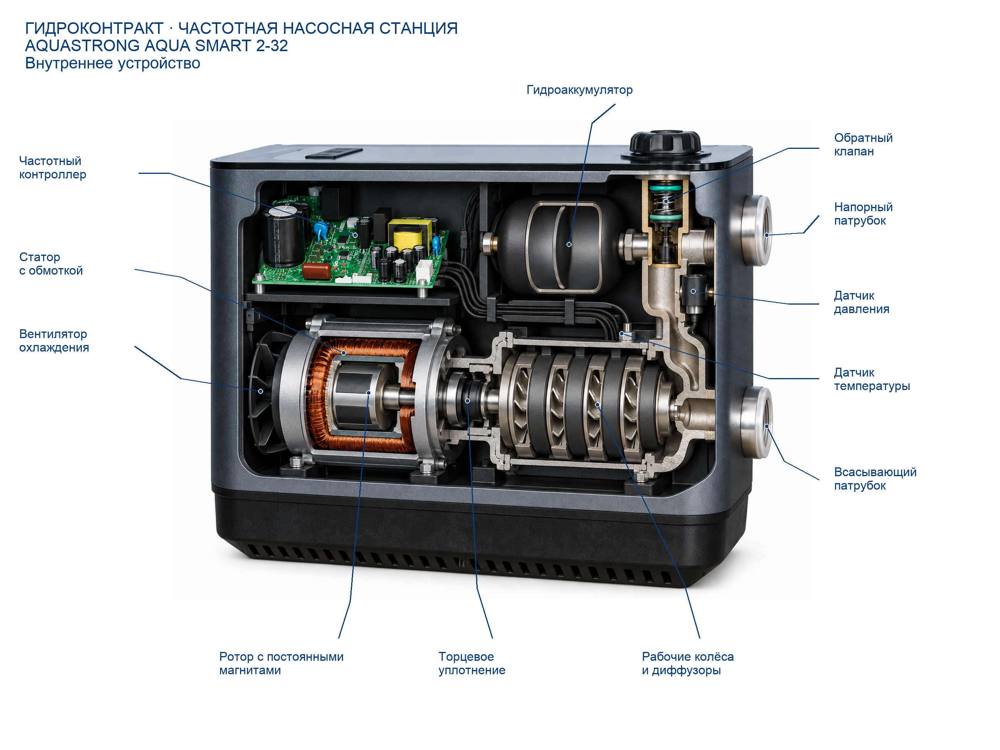

# AQUASTRONG Aqua SMART 2-32: итог пилота

Лучший вариант: **2**, рейтинг **86/100**.
Рейтинг сравнивает варианты, а не измеряет вероятность технической правильности.
Скрипт складывает наблюдения проверяющего агента и не распознаёт изображение: ошибочные отметки могут дать высокий балл неверному разрезу.
Попытки: 3/5. Причина остановки: После двух рабочих изображений и одного намеренно ошибочного контроля выбран вариант2. Исправлены различимость колёс/диффузоров и окно бака. Дальнейшие вызовы не разрешат неизвестные модельные факты;2 попытки сохранены. Рейтинг не независимая экспертиза..
Технический специалист ещё не подтвердил результат.

## Проверка выбранного варианта

- Конструкция: 31/45.
- Расположение и связи: 25/25.
- Функциональная полнота: 15/15.
- Внешнее сходство: 10/10.
- Ясность и выноски: 5/5.
- Этап оценки: captioned; разрез без подписей: 83/100.
Баллы, добавленные за подписи, не означают улучшение внутренней конструкции.

Критические противоречия: не обнаружены в проведённой проверке.
Непроверенные критические пункты: нет.
- motor-material (unknown): Точный признак не установлен по источникам.
- hydraulics-type_count (unknown): Точный признак не установлен по источникам.
- hydraulics-material (unknown): Точный признак не установлен по источникам.
- manifold-material (unknown): Точный признак не установлен по источникам.
- tank-shape (unknown): Точный признак не установлен по источникам.
- tank-material (unknown): Точный признак не установлен по источникам.
- controller-material (unknown): Точный признак не установлен по источникам.
- cooling-material (unknown): Точный признак не установлен по источникам.

## Состояние результата

Нужна техническая проверка: существенные признаки не подтверждены.
Основания статуса: motor-material, hydraulics-type_count, hydraulics-material, manifold-material, tank-shape, tank-material, controller-material, cooling-material.
Этот статус не означает одобрение специалистом или разрешение публикации.

## Подтверждение отдельных признаков

Счётчики относятся к существенным внутренним признакам, а не к проценту достоверности всего изделия. Потолок баллов учитывает весь checklist.
- Основание model: 0 (нет).
- Основание series: 22 (motor-type_count, motor-shape, hydraulics-shape, manifold-type_count, manifold-shape, tank-type_count, controller-type_count, controller-shape, cooling-type_count, cooling-shape, motor-attachment, motor-placement_connections, hydraulics-attachment, hydraulics-placement_connections, manifold-attachment, manifold-placement_connections, tank-attachment, tank-placement_connections, controller-attachment, controller-placement_connections, cooling-attachment, cooling-placement_connections).
- Основание analog: 0 (нет).
- Основание unknown: 8 (motor-material, hydraulics-type_count, hydraulics-material, manifold-material, tank-shape, tank-material, controller-material, cooling-material).
- Совпадение изображения с основанием model: 0 (нет).
- Совпадение изображения с основанием series: 22 (motor-type_count, motor-shape, hydraulics-shape, manifold-type_count, manifold-shape, tank-type_count, controller-type_count, controller-shape, cooling-type_count, cooling-shape, motor-attachment, motor-placement_connections, hydraulics-attachment, hydraulics-placement_connections, manifold-attachment, manifold-placement_connections, tank-attachment, tank-placement_connections, controller-attachment, controller-placement_connections, cooling-attachment, cooling-placement_connections).
- Совпадение изображения с основанием analog: 0 (нет).
- unverified: motor-material, hydraulics-type_count, hydraulics-material, manifold-material, tank-shape, tank-material, controller-material, cooling-material.
- contradicted: нет.
- partial: нет.
Недоступные по текущим источникам баллы: 14; пункты: motor-material, hydraulics-type_count, hydraulics-material, manifold-material, tank-shape, tank-material, controller-material, cooling-material.
Потолок по имеющимся основаниям: 86/100. Это не обещание получить данный балл.

| Пункт | Узел / признак | Основание | Статус | Источник / локатор | Сопоставление |
|---|---|---|---|---|---|
| motor-type_count | motor / type_count | series | pass | catalog: Catalogue PDF/printed28, SMART assembly/key | Наличие PM-двигателя из текста каталога согласуется с показанными магнитными вставками; их число не подтверждено. |
| motor-shape | motor / shape | series | pass | catalog: Catalogue PDF/printed28, SMART assembly/key | Согласуется с вложением19/20/21 на деталировке, без подтверждения точных размеров. |
| motor-material | motor / material | unknown | unknown | catalog: Catalogue PDF/printed28, SMART assembly/key | Источник не содержит этого факта: Catalogue omits complete winding/magnet/housing materials |
| hydraulics-type_count | hydraulics / type_count | unknown | unknown | catalog: Catalogue PDF/printed28, SMART assembly/key | Источник не содержит этого факта: Family diagram shows repeated stages but exact model count not specified |
| hydraulics-shape | hydraulics / shape | series | pass | catalog: Catalogue PDF/printed28, SMART assembly/key | Общие профили8/9 теперь различимы и разделены. Точная форма лопаток и каналов остаётся реконструкцией, число ступеней unknown. |
| hydraulics-material | hydraulics / material | unknown | unknown | catalog: Catalogue PDF/printed28, SMART assembly/key | Источник не содержит этого факта: Supplier says stainless wheel; branded sources lack applicable material table |
| manifold-type_count | manifold / type_count | series | pass | catalog: Catalogue PDF/printed28, SMART assembly/key | Соответствуют функциональным узлам13/12/25; точная внутренняя геометрия датчиков не доказана. |
| manifold-shape | manifold / shape | series | pass | catalog: Catalogue PDF/printed28, SMART assembly/key | Общая форма узла14/13 соответствует серии; каналы остаются реконструкцией. |
| manifold-material | manifold / material | unknown | unknown | catalog: Catalogue PDF/printed28, SMART assembly/key | Источник не содержит этого факта: Catalogue omits material specification |
| tank-type_count | tank / type_count | series | pass | catalog: Catalogue PDF/printed28, SMART assembly/key | Компактный узел10 на деталировке и фото запчасти, число один. |
| tank-shape | tank / shape | unknown | unknown | catalog: Catalogue PDF/printed28, SMART assembly/key | Источник не содержит этого факта: Tank10 is closed component; diaphragm unexposed |
| tank-material | tank / material | unknown | unknown | catalog: Catalogue PDF/printed28, SMART assembly/key | Источник не содержит этого факта: Manufacturer sources omit materials |
| controller-type_count | controller / type_count | series | pass | catalog: Catalogue PDF/printed28, SMART assembly/key | Узел3 и частотное регулирование из каталога, не механическое реле. |
| controller-shape | controller / shape | series | pass | catalog: Catalogue PDF/printed28, SMART assembly/key | Согласуется с общей формой/ориентацией1–3; точные дорожки не проверены. |
| controller-material | controller / material | unknown | unknown | catalog: Catalogue PDF/printed28, SMART assembly/key | Источник не содержит этого факта: Applicable material facts omitted |
| cooling-type_count | cooling / type_count | series | pass | catalog: Catalogue PDF/printed28, SMART assembly/key | Отдельный задний вентилятор24, без второго внешнего вентилятора. |
| cooling-shape | cooling / shape | series | pass | catalog: Catalogue PDF/printed28, SMART assembly/key | Отличим от насосных металлических колёс8; схема24. |
| cooling-material | cooling / material | unknown | unknown | catalog: Catalogue PDF/printed28, SMART assembly/key | Источник не содержит этого факта: No material table for24 |
| motor-attachment | motor / attachment | series | pass | catalog: Catalogue PDF/printed28, SMART assembly/key | Поддержанная деталировкой вложенная сборка, не два раздельных цилиндра. |
| motor-placement_connections | motor / placement_connections | series | pass | catalog: Catalogue PDF/printed28, SMART assembly/key | Общая взаимная компоновка по схеме; точные зазоры неизвестны. |
| hydraulics-attachment | hydraulics / attachment | series | pass | catalog: Catalogue PDF/printed28, SMART assembly/key | Различимы колесо–вал и отдельный стационарный направляющий элемент9; точные внутренние сопряжения не доказаны. |
| hydraulics-placement_connections | hydraulics / placement_connections | series | pass | catalog: Catalogue PDF/printed28, SMART assembly/key | Относительное расположение согласуется со схемой, без подтверждения всех каналов. |
| manifold-attachment | manifold / attachment | series | pass | catalog: Catalogue PDF/printed28, SMART assembly/key | Общие связи13/12/14/15 видимы; работа конкретного канала не установлена. |
| manifold-placement_connections | manifold / placement_connections | series | pass | catalog: Catalogue PDF/printed28, SMART assembly/key | Сохранены нижний/верхний патрубки и расположение верхнего узла; скрытая трасса не доказана. |
| tank-attachment | tank / attachment | series | pass | catalog: Catalogue PDF/printed28, SMART assembly/key | Видимое боковое присоединение10 к14. |
| tank-placement_connections | tank / placement_connections | series | pass | catalog: Catalogue PDF/printed28, SMART assembly/key | Общая компоновка10/14, без внешнего резервуара. |
| controller-attachment | controller / attachment | series | pass | catalog: Catalogue PDF/printed28, SMART assembly/key | Плата отделена от открытого насоса, соответствует защищённой компоновке1–3. |
| controller-placement_connections | controller / placement_connections | series | pass | catalog: Catalogue PDF/printed28, SMART assembly/key | Соответствует верхнему отсеку деталировки. |
| cooling-attachment | cooling / attachment | series | pass | catalog: Catalogue PDF/printed28, SMART assembly/key | Схема24 относительно20/23, внутреннее крепление частично закрыто. |
| cooling-placement_connections | cooling / placement_connections | series | pass | catalog: Catalogue PDF/printed28, SMART assembly/key | Поддержанная общая компоновка заднего охлаждения. |
| nodes-visible | оформление / delivery | series | pass | catalog: Applicable source image / project presentation requirement | Наличие узлов из каталога; не означает правильную скрытую форму. |
| mechanism-readable | оформление / delivery | series | pass | catalog: Applicable source image / project presentation requirement | Основные отношения19/20/21 и8/9 наглядны. Это функциональная различимость, не совпадение каждой лопатки с заводом. |
| physical-boundaries | оформление / delivery | analog | pass | catalog, tank-principle: Applicable source image / project presentation requirement | Соответствует реконструируемому принципу разделения полостей Grundfos и общей сборке каталога. Точная трасса и мембрана SMART2-32 остаются unknown. |
| store-identity | оформление / delivery | photo | pass | store: Applicable source image / project presentation requirement | Рамка наружного облика сопоставлена с магазинным фото; окно намеренно удаляет панель. |
| store-ports | оформление / delivery | photo | pass | store: Applicable source image / project presentation requirement | Фото магазина, без третьего наружного порта/внешнего бака. |
| dry | оформление / delivery | style | pass | presentation: Applicable source image / project presentation requirement | Согласованная сухая база соблюдена. |
| natural-cuts | оформление / delivery | style | pass | presentation: Applicable source image / project presentation requirement | Согласованная подача срезов, точный состав материала отдельно unknown. |
| captions | оформление / delivery | series | pass | catalog: Applicable source image / project presentation requirement | Названия по деталировке28 и точный суффикс2-32; никаких неподтверждённых чисел ступеней/материалов не подписано. |

## Основания и реконструкция

- model: нет.
- series: Двигатель, Гидравлическая часть и торцевое уплотнение, Напорный узел, клапан и датчики, Гидроаккумулятор, Частотный контроллер, Вентилятор.
- analog: нет.
- unknown: нет.
- Ограничение: Exact SMART2-32 stage count unknown; four illustrative stages chosen from series drawing as reconstruction.
- Ограничение: Rotor magnet pattern, exact internal hydraulic channels and vane shape unexposed.
- Ограничение: Tank diaphragm form/clamp/material unexposed; separation reconstructed from Grundfos principle.
- Ограничение: Most manufacturer material specifications unavailable; supplier statements kept separately.
- Ограничение: No usable exact internal CAD/3D in inspected entry points; video found but not viewed or used.
- Реконструкция по аналогам: Supplier parts constrain tank, valve and board visual profiles, not manufacturer confirmation.
- Реконструкция по аналогам: Only flexible diaphragm separation principle from Grundfos; no size/material/clamp transfer.

## История вариантов

| Версия | Рейтинг | Этап / база | Критические ошибки | Замечания и исправления |
|---|---:|---|---|---|
| 1 | 67 | base / 67 | — | Геометрия основных узлов хорошо разделена, но рабочие колёса слишком открытые, диффузоры не показаны; мембранные полости плохо читаются. |
| 2 | 86 | captioned / 83 | — | Исправлена различимость закрытых колёс/направляющих и разделения полостей бака. Сохранились подтверждённые общие компоновка и внешний вид; точные число ступеней, геометрия мембраны/каналов и материалы не установлены. Исправлено: Разделены колёса и диффузоры; Небольшое окно с тонкой разделяющей мембраной вместо цельного купола |
| 3 | 58 | base / 58 | manifold-attachment, natural-cuts | Контрольный ошибочный PNG: клапан не в той ветви, вентилятор на противоположном конце мотора, контроллер отсутствует; дополнительно появился декоративный узор. Проверены реальные пиксели, не только текст тестового задания. |

## Источники

- [store](https://477477.ru/images/products/_transparent-v1/gk-1016090708-47f509ec51af0e39-detail-2ca2d171b2813ed0-detail.webp): product_photo; Exact card GK-1016090708 observed and photo downloaded; exterior only
- [AQUASTRONG SMART branded manual, supplier-hosted](https://gidrokontrakt.ru/f/smart_smartz_smartmini.pdf): manufacturer_series; PDF1–7 visually inspected; exact SMART2-32 on PDF3 printed2–3, no internal section; date/edition not specified
- [AQUASTRONG branded domestic technical catalogue2025](https://gidrokontrakt.ru/f/katalog_aquastrong_bytovye_nasosy_2025.pdf): manufacturer_series; PDF/printed28 has common SMART assembly/key and exact SMART2-32 table. PDF29 Z/30 SMART45 inspected to exclude. Family drawing does not prove exact count/dimensions for2-32
- [parts](https://gidrokontrakt.ru/magazin/product/chastotnaya-nasosnaya-stanciya-aquastrong-aqua-smart-2-32): analog; Linked exact SMART2-32 tank, valve13, board3 photos inspected; reconstruction aids only, supplier materials not manufacturer proof
- [tank-principle](https://www.grundfos.com/solutions/learn/research-and-insights/diaphragm-tank): analog; Inspected flexible diaphragm, gas side and manifold principle; no dimensions, materials, clamp or exact target shape transferred
- [presentation](https://github.com/C555HC/plumbing-detailing-/blob/main/.agents/skills/product-cutaway-agent/references/layers.md): style_reference; Current user-authorized dry natural cutaway presentation contract; no internal evidence

## Архив доказательств

- store, inputs v1, Exact store card photo, GK-1016090708: Exterior photo fixes silhouette/two stacked ports/top cap; [файл](../evidence/files/87cbe369520ea9e5bdcad26e7b4d0e8b61d8ece895f6c8e54b7e8a9e00a1a930.webp).
- manual, inputs v1, PDF3 printed2–3: SMART2-32 non-Z listed, 370W, exterior dimensions; [файл](../evidence/files/c59c778aeb358adfeaf1ddd22e8a14afadec4582d67b5687123841e80aa083bd.png).
- catalog, inputs v1, PDF/printed28 SMART assembly/key: Coarse assembly of motor/hydraulic package/upper fitting/tank/board/fan; [файл](../evidence/files/aa882d92b97d933120afb26d881e7a597430efdaa46107e7c071d936859ae6ce.png).
- catalog, inputs v1, Crop from PDF28, large assembly/key: Selected technical reference for generator; same source, not new evidence; [файл](../evidence/files/6ecae44e4b734e17d2c6dfaa0f6caf11257d0a3ed2d2c375041be8fc31b3db3c.png).
- parts, inputs v1, Supplier linked SMART2-32 accumulator photograph: Compact round puck exterior; membrane unexposed; [файл](../evidence/files/0bdb86fded29989065fcdc313953b941b026f059a1722bc09c29c06f97931187.png).
- parts, inputs v1, Supplier linked valve13 photograph: Spring-loaded black cage with two green O-rings; [файл](../evidence/files/00d8be48f2a1264dd5d59962eac7391e085d65203ab57ed59ef6631e467d1c29.png).
- parts, inputs v1, Supplier linked board3 photograph: Rectangular board with large capacitor and transformer; [файл](../evidence/files/449e0c8b8e4d700e0895eb6264386779a873c75e76bd6e5c7273b22fe5805756.png).
- tank-principle, inputs v1, Grundfos diaphragm-tank page, inspected text: Flexible separation and gas side; no shape transferable; не сохранено: Text read via web tool; no actual section image supplied.
- presentation, inputs v1, Current skill layers.md: Dry natural cut requirements; не сохранено: Instruction contract, no visual evidence asset.

## Проверка подписей

По всем выноскам зарегистрированы проверка названия и визуальный осмотр конечных точек. Это проверка агентом, не автоматическое распознавание деталей.
