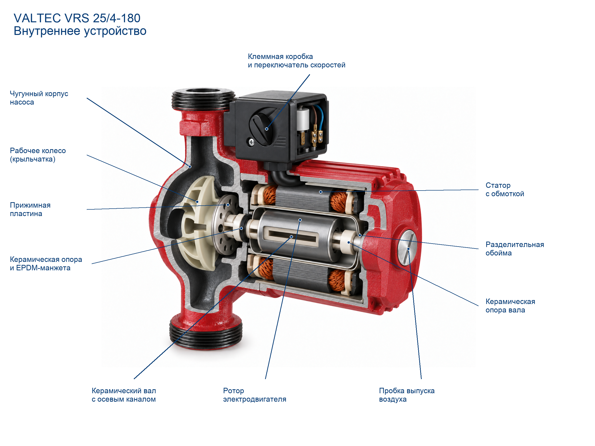

# VALTEC VRS.254.18.0: итог пилота

Лучший вариант: **3**, рейтинг **90/100**.
Рейтинг сравнивает варианты, а не измеряет вероятность технической правильности.
Скрипт складывает наблюдения проверяющего агента и не распознаёт изображение: ошибочные отметки могут дать высокий балл неверному разрезу.
Попытки: 3/5. Причина остановки: Selected003 after whole-frame/source rereview: oneventplug, preserved wetrotor nesting; no more source-supported correction, inlet path still unverified. Stop3/5..
Технический специалист ещё не подтвердил результат.

## Проверка выбранного варианта

- Конструкция: 40/45.
- Расположение и связи: 20/25.
- Функциональная полнота: 15/15.
- Внешнее сходство: 10/10.
- Ясность и выноски: 5/5.
- Этап оценки: captioned; разрез без подписей: 87/100.
Баллы, добавленные за подписи, не означают улучшение внутренней конструкции.

Критические противоречия: не обнаружены в проведённой проверке.
Непроверенные критические пункты: нет.
- impeller-shape (unknown): Wheel partlysectioned to show centraleye and radialpassages; exactcurrentbladeprofile stillunavailable.
- impeller-placement_connections (unknown): Central wheel eye exposed, but lower inlet cavity still opens peripheral volute; hidden eye inlet passage not established.
- rotor-material (unknown): Exact rotor alloy unconfirmed.
- stator-material (unknown): Copper-looking winding and grey stack, materials not specified in relied-on source.

## Состояние результата

Нужна техническая проверка: существенные признаки не подтверждены.
Основания статуса: impeller-shape, impeller-placement_connections, rotor-material, stator-material.
Этот статус не означает одобрение специалистом или разрешение публикации.

## Подтверждение отдельных признаков

Счётчики относятся к существенным внутренним признакам, а не к проценту достоверности всего изделия. Потолок баллов учитывает весь checklist.
- Основание model: 0 (нет).
- Основание series: 27 (housing-type_count, housing-shape, housing-attachment, housing-placement_connections, housing-material, impeller-type_count, impeller-attachment, impeller-placement_connections, impeller-material, rotor-type_count, rotor-shape, rotor-attachment, rotor-placement_connections, stator-type_count, stator-shape, stator-attachment, stator-placement_connections, barrier-type_count, barrier-shape, barrier-attachment, barrier-placement_connections, barrier-material, shaft-type_count, shaft-shape, shaft-attachment, shaft-placement_connections, shaft-material).
- Основание analog: 0 (нет).
- Основание unknown: 3 (impeller-shape, rotor-material, stator-material).
- Совпадение изображения с основанием model: 0 (нет).
- Совпадение изображения с основанием series: 26 (housing-type_count, housing-shape, housing-attachment, housing-placement_connections, housing-material, impeller-type_count, impeller-attachment, impeller-material, rotor-type_count, rotor-shape, rotor-attachment, rotor-placement_connections, stator-type_count, stator-shape, stator-attachment, stator-placement_connections, barrier-type_count, barrier-shape, barrier-attachment, barrier-placement_connections, barrier-material, shaft-type_count, shaft-shape, shaft-attachment, shaft-placement_connections, shaft-material).
- Совпадение изображения с основанием analog: 0 (нет).
- unverified: impeller-shape, impeller-placement_connections, rotor-material, stator-material.
- contradicted: нет.
- partial: нет.
Недоступные по текущим источникам баллы: 5; пункты: impeller-shape, rotor-material, stator-material.
Потолок по имеющимся основаниям: 95/100. Это не обещание получить данный балл.

| Пункт | Узел / признак | Основание | Статус | Источник / локатор | Сопоставление |
|---|---|---|---|---|---|
| housing-type_count | housing / type_count | series | pass | manual: PDF2 §4 illustration | Одноступенчатый моноблочный центробежный корпус в PDF2 exploded. Comparison: Single left volute castiron body with upper/lower opposing connections. |
| housing-shape | housing / shape | series | pass | manual: PDF2 §4 illustration | PDF2 illustration shows paired inline connections and volute. Comparison: Deep curved dark hydraulic cavity and threaded vertical necks. |
| housing-attachment | housing / attachment | series | pass | manual: PDF2 §4 illustration | PDF2 exploded order and section5.11 four fixing screws. Comparison: Body joins motor through vertical mating flange, no floating gap. |
| housing-placement_connections | housing / placement_connections | series | pass | manual: PDF2 §4 illustration | PDF2 exploded chamber behind single impeller; current photo vertical opposed ports. Comparison: Lower cavity shown continuous peripheral around wheel; central-eye connection not established. |
| housing-material | housing / material | series | pass | manual: PDF2 §4 illustration | Manual4.3 cast iron. Comparison: Grey rough cut substrate and exterior red paint. |
| impeller-type_count | impeller / type_count | series | pass | manual: PDF2 §4 illustration | PDF2 exploded single impeller and assembly figure6. Comparison: One pale shallow polymer centrifugal wheel at left. |
| impeller-shape | impeller / shape | unknown | unknown | manual: PDF2 §4 illustration | Sources omit precise current blade profile/count. Comparison: Precise curved-blade profile cannot be compared to manufacturer; omitted there. |
| impeller-attachment | impeller / attachment | series | pass | assembly: PDF13 / printed12 figure1–7 and text | Historical assembly item6 coaxial with2 and current PDF2 order. Comparison: White shaft enters central wheel hub through plate. |
| impeller-placement_connections | impeller / placement_connections | series | unknown | manual: PDF2 §4 illustration | PDF2 exploded housing-wheel-rotor sequence. Comparison: Central wheel eye exposed, but lower inlet cavity still opens peripheral volute; hidden eye inlet passage not established. |
| impeller-material | impeller / material | series | pass | manual: PDF2 §4 illustration | Manual4.3 glass reinforced polypropylene. Comparison: Pale nonmetal wheel contrasting metalplate, consistent PP-GF appearance only. |
| rotor-type_count | rotor / type_count | series | pass | manual: PDF2 §4 illustration | Manual4.1–4.2 and PDF2 exploded. Comparison: One central smooth cylindrical rotor, not permanentmagnet cup. |
| rotor-shape | rotor / shape | series | pass | manual: PDF2 §4 illustration | PDF2 rotor is cylinder; historical assembly1 cylindrical. Comparison: Grey cylinder extends axially between ceramic collars. |
| rotor-attachment | rotor / attachment | series | pass | assembly: PDF13 / printed12 figure1–7 and text | Assembly1–2 common axis; PDF2 order. Comparison: Rotor coaxial to white shaft, same drive axis as wheel. |
| rotor-placement_connections | rotor / placement_connections | series | pass | manual: PDF2 §4 illustration | Manual exploded rotor nested in stator/can assembly. Comparison: Cylinder inside thin enclosing can; stator outside can. |
| rotor-material | rotor / material | unknown | unknown | manual: PDF2 §4 illustration | Relied-on sources omit alloy. Comparison: Exact rotor alloy unconfirmed. |
| stator-type_count | stator / type_count | series | pass | manual: PDF2 §4 illustration | Manual4.4 specifies winding, exploded shows annular stator. Comparison: Upper/lower winding/core portions of one annular fixed stator. |
| stator-shape | stator / shape | series | pass | manual: PDF2 §4 illustration | Manual PDF2 exploded circular stator. Comparison: Section of surrounding ring, winding end turns and long lamination stack. |
| stator-attachment | stator / attachment | series | pass | manual: PDF2 §4 illustration | Manual PDF2 exploded sequence and4.3 housing. Comparison: Fixed core rests within outermotorcasing, not floating onshaft. |
| stator-placement_connections | stator / placement_connections | series | pass | assembly: PDF13 / printed12 figure1–7 and text | Assembly text impermeable stainless can separates rotor/stator. Comparison: Coils outside thin metalcan; no intrusion into rotor cavity. |
| stator-material | stator / material | unknown | unknown | manual: PDF2 §4 illustration | Exact winding/core materials not specified in these sources. Comparison: Copper-looking winding and grey stack, materials not specified in relied-on source. |
| barrier-type_count | barrier / type_count | series | pass | assembly: PDF13 / printed12 figure1–7 and text | Assembly printed12 text impermeable can. Comparison: One thin metal separator surrounding rotor. |
| barrier-shape | barrier / shape | series | pass | manual: PDF2 §4 illustration | Manual PDF2 exploded circular can around rotor; no precision thickness. Comparison: U-shaped axial cut outline round rotor, coherent cylindrical sleeve. |
| barrier-attachment | barrier / attachment | series | pass | assembly: PDF13 / printed12 figure1–7 and text | Assembly text impermeable barrier. Comparison: Sleeve wall closes outer compartment boundary; small end opening represented. |
| barrier-placement_connections | barrier / placement_connections | series | pass | assembly: PDF13 / printed12 figure1–7 and text | Assembly text separation and manual nested ordering. Comparison: Thin sleeve between rotor and stator clearly visible above/below. |
| barrier-material | barrier / material | series | pass | assembly: PDF13 / printed12 figure1–7 and text | Assembly printed12 text. Comparison: Neutral polished thin metalwall; specific stainless grade not distinguishable, fits general appearance. |
| shaft-type_count | shaft / type_count | series | pass | assembly: PDF13 / printed12 figure1–7 and text | Assembly2,3,4; current exact card ceramic shaft/bearings/thrustwashers. Comparison: Pale shaft, front/rear pale collars and small black elastic ring visible. |
| shaft-shape | shaft / shape | series | pass | assembly: PDF13 / printed12 figure1–7 and text | Assembly2 white cylinder,3 bearing collar,4 thrustwasher. Comparison: Straight shaft and annular collars at both ends; bore hidden. |
| shaft-attachment | shaft / attachment | series | pass | assembly: PDF13 / printed12 figure1–7 and text | Assembly4–5 and current card describe elastic EPDM cuff. Comparison: Front blackcuff backed with palethrust element against plate; rear collar mates to shaft. |
| shaft-placement_connections | shaft / placement_connections | series | pass | assembly: PDF13 / printed12 figure1–7 and text | Assembly text plate7 holes -> rotor compartment -> channel shaft2. Comparison: Axial ceramic-lined empty slot now exposed through rotor and pale front/rearshaft stubs, all on commonaxis. |
| shaft-material | shaft / material | series | pass | assembly: PDF13 / printed12 figure1–7 and text | Exact card and assembly ceramic bearings/shaft/washers, EPDM cuff. Comparison: Offwhite supports/shaft, blackelastic cuff consistent ceramic/EPDM visual roles. |
| nodes-visible | оформление / delivery | series | pass | manual: PDF2 §4 / PDF13 printed12 | Manufacturer exploded assembly differentiates housing/wheel/rotor/can/stator/shaft. Comparison: Housing/wheel/rotor/stator/can/shaft/collars clearly separated in readable full window. |
| cooling-path | оформление / delivery | series | pass | assembly: PDF2 §4 / PDF13 printed12 | Assembly text plate7 holes and shaft2 axial return; geometry simplified. Comparison: Empty slot runs longitudinally within ceramic shaft; large platehole opens chamber, nofluid. |
| no-extra | оформление / delivery | series | pass | manual: PDF2 §4 / PDF13 printed12 | Manual VRS single wet-rotor assembly. Comparison: No tank/fan/multistage stack, one wetrotor assembly. |
| silhouette | оформление / delivery | photo | pass | photo: Store-card primary photo | Exact storephoto shows one frontsilverventplug, current output oneplug; cut pose moderatelydifferent. |
| controls | оформление / delivery | photo | pass | photo: Store-card primary photo | Actual card left black terminal box, speed switch, cable. Comparison: Black speedknob box restored to motor upperleft, matching relative store side; wiring and cableentry visible. |
| dry | оформление / delivery | series | pass | manual: PDF2 §4 / PDF13 printed12 | User dry-master delivery rule; sources used for empty physical passages. Comparison: Empty cavities; no water. Blue terminal wire is electrical insulation, not liquid. |
| natural | оформление / delivery | series | pass | manual: PDF2 §4 / PDF13 printed12 | User natural-substrate rule; manual4.3 castiron/aluminium/polymer. Comparison: Neutralmetal/polymer/ceramic sectionfaces without coloredcontourstrip; exteriorredpaint allowed. |
| captions | оформление / delivery | series | pass | manual: PDF2 §4 / PDF13 printed12 | Named functionalparts in factorymanual/assembly; no unsupportedprecisebladecount caption. |

## Основания и реконструкция

- model: нет.
- series: Чугунный гидравлический корпус, Крыльчатка, Ротор, Статор с обмоткой, Водонепроницаемая обойма, Керамический вал и опоры.
- analog: нет.
- unknown: нет.
- Ограничение: Exact current impeller blade profile/count unavailable; educational curved-channel reconstruction.
- Ограничение: Rotor alloy and stator winding/core exact materials not specified in relied-on sources.
- Ограничение: Current exact cross-section/CAD internals not visually inspected; historical2015 family geometry is qualified, no production-revision guarantee.

## История вариантов

| Версия | Рейтинг | Этап / база | Критические ошибки | Замечания и исправления |
|---|---:|---|---|---|
| 1 | 75 | base / 75 | — | Nested wetrotor mechanism distinguishable. Hollow shaft/inlet eye path unverified and terminalbox moved; no captiongate yet. |
| 2 | 83 | captioned / 80 | — | Shaftbore and terminalbox improved; duplicate ventplug regression, central inlet-to-eye still unverified. Исправлено: Longitudinal shaft lumen exposed; Terminalbox leftupperposition restored |
| 3 | 90 | captioned / 87 | — | Oneplug restored. Rotor/can/stator order preserved; centraleye-to-inlet path still unverified, profile/material unknowns unchanged. Исправлено: Longitudinal shaft lumen exposed; Terminalbox leftupperposition restored; Duplicate ventplug removed |

## Источники

- [Фотография выбранной карточки](https://477477.ru/images/products/_transparent-v1/vrs.254.18.0-7272e9f1a4ac0860-detail-6a62f4550434e6bd-detail.webp): product_photo; Exact store article VRS.254.18.0, exterior only
- [VALTEC VRS.254.18](https://valtec.ru/catalog/nasosnoe_oborudovanie/nasosy_cirkulyacionnye/nasos_cirkulyacionnyj_vrs_254_180.html): manufacturer_model; Exact model, current description and CAD links
- [VRS паспорт ПС47522-2, 0725](https://valtec.ru/document/technical/VRS-0725.pdf): manufacturer_series; Lists254.180 in table; PDF2 section4 exploded family drawing, not precision model CAD
- [Новинки2015, VRS, печатная12 / PDF13](https://valtec.ru/document/Valtec-new-2015.pdf): manufacturer_series; Historical VRS assembly 1–7 matches current described ceramic shaft/supports/EPDM and wet rotor. Supports family arrangement only, not exact current blade profile or tolerances.

## Архив доказательств

- photo, inputs v1, Store primary gallery: Exact selected red pump exterior; [файл](../evidence/files/d1be7bdf89bb27193e2fd0d0fbadbeba8fb08553ed472a81c3a3bb876d91df68.webp).
- manual, inputs v1, PDF2 §4 and exploded: Nested rotor/can/stator and single wheel; [файл](../evidence/files/b998f9bdedf99fc18a9a5848d986c5f52fb17705997d551b60d113b039e92b44.png).
- assembly, inputs v1, PDF13 / printed12 figure1–7: Ceramic supports, EPDM and shaft channel; [файл](../evidence/files/1ea5b6a34698b19d99b92920fc00f6ec48dc8a26ebfec797a1568c13be4dd3cd.png).
- card, inputs v1, Exact model description and CAD links: Materials and coolant route; CAD not section-inspected; [файл](../evidence/files/956b472c1908760bf8867c7a204fae9bfd6f88020daee1c09f349101a8ba83b0.txt).

## Проверка подписей

По всем выноскам зарегистрированы проверка названия и визуальный осмотр конечных точек. Это проверка агентом, не автоматическое распознавание деталей.
