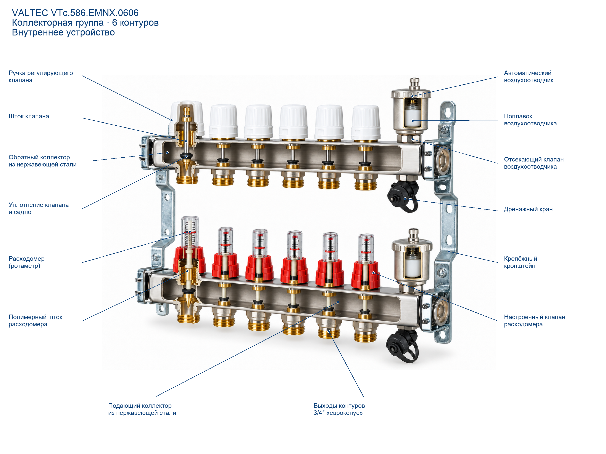

# VALTEC VTc.586.EMNX.0606 — коллекторная группа в разрезе

14.10.2026, Europe/Saratov. [Магазин](https://477477.ru/catalog/otoplenie-i-kotelnaya/valtec-vtc-586-emnx-0606). SKU VTc.586.EMNX.0606,1″,6контуров, выходы3/4″евроконус. Представитель семейства выбран агентом по общему названию.

[PNG](final/best.png) · [Подробный отчёт](final/report.md) · [Все варианты](attempts) · [Ошибки/ограничения](work-log.md) · [Повторное сравнение](research/final-comparison.md)

| Вариант | База | Карточка | Результат |
|---|---:|---:|---|
|1|70|—|Сплошные столбики вместо читаемой клапанной сборки, металлический шток ротаметра|
|2 — выбранный|91|94|Тонкие штоки/прокладки/седла, раскрытые ниппели, полимерные штоки;14подписей|

2/5последовательных вызова Codex/imagegen; подписи без генерации. Отinitпосле сохранения магазинного фото доfinalize13мин23с; начальный поиск и отправкаGitHub отдельно. Время генераторных вызовов34,7+43,9с, не измерение расхода лимитов.

Основания: [точная таблица модели/комплектующие](https://valtec.ru/catalog/sistemy_vodyanogo_teplogo_pola/kollektornye_bloki/kollektornyj_blok_iz_nerjaveyushej_stali_so_vstroennymi_rashodomerami_vtc586emnx.html), [паспорт586-1024 PDF2/3/6](https://valtec.ru/document/technical/VTc.586.EMNX-1024.pdf), [AC674](https://valtec.ru/catalog/kollektornye_sistemy/komplektuyuschie_dlya_kollektorov/rashodomer_kollektornyj_vtac674.html). [502N0924](https://valtec.ru/document/technical/VT.502.N-0924.pdf) — только аналогия поплавкового принципа, другая внешняя конструкция/производственная ревизия.

**Нужна проверка экспертом.**94 — текущий checklist, не94%достоверности. Не подтверждены точные внутренние профили/зазоры клапанов/расходомеров/воздухоотводчиков/дренажей;6балловunknown. Геометрия частично реконструирована, её нельзя принимать за заводское сечение. Рейтинг проверен обычным осмотром тем же агентом, независимого оценщика нет.

Важная проверка входа: карточка0603использовала то же общее фото с6контурами. До запуска выбран0606, где SKU/число совпали. Имяфайла0602само по себе не определяет модель фотографии. Полные сторонниеPDFне опубликованы, только просмотренные страницы/исходныйWebPи их происхождение. Рабочий скилл/лимит5не менялись.
